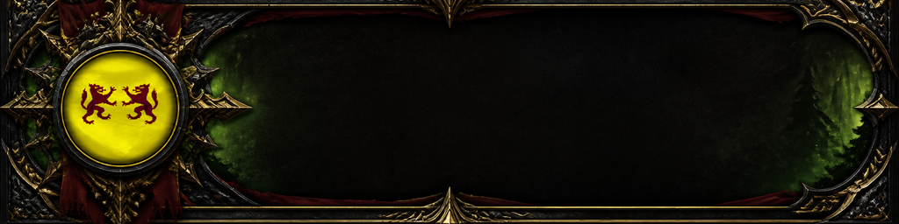

# Chevaliers Translators (v0.17.6)



Traduction du chat de World of Warcraft entre les langues européennes, **sur le PC du joueur**
(llama.cpp, aucun serveur en ligne). Deux parties :

- l'**addon** `ChevaliersTranslators` (toutes les versions du jeu : Retail, Forever, Classic...)
  relaie le chat par un bandeau de pixels en bas à droite de l'écran et cache le texte des
  messages de joueurs ;
- l'**application** `ChevaliersTranslators.exe` (Windows) lit le bandeau, traduit, et redessine
  le chat traduit par-dessus le jeu (chat miroir) ; Maj+Entrée dans la boîte de saisie envoie ton
  texte traduit.

Règle : tout message dans une autre langue que celle du joueur est traduit dans sa langue de
lecture (celle du client de WoW, ou celle de Windows quand WoW n'existe pas dans celle-ci, 0.17.1) ; les acronymes du jeu passent par le dictionnaire, les noms de lieux, donjons et raids
prennent le nom du client (`app/data/termes.tsv`).

Code source : <https://github.com/Heaumite/chevaliers-translators>, sous licence **GPL-3.0 ou
ultérieure** (`LICENSE`). Signature du code : `docs/CODE_SIGNING_POLICY.md` (demande à SignPath
Foundation : `docs/SIGNPATH.md`).

Phase 1, jalon J1 (fondation) : `docs/PLAN_PHASE1.md`. Phase 0 (kit de test, résultats) :
`docs/PHASE0.md`, `docs/BILAN_PHASE0.md`, `docs/REGLE_MODELES.md`.

## Pour le joueur

Une fois installé, l'addon fonctionne pour toutes les versions de World of Warcraft, dans toutes les
langues européennes : il traduit les langues étrangères vers la langue d'origine du joueur, peu
importe de quel pays il vient. Il se met à jour automatiquement depuis ce dépôt.

**Addon incompatible** : *WoW Translator* (il ajoute ses traductions dans le texte des messages du
chat ; Chevaliers Translators ne retrouve plus ces messages). L'addon le signale à la connexion et
dans le guide : le désactiver dans la liste des addons.

1. Lancer `ChevaliersTranslators.exe` : la **fenêtre des modèles** s'ouvre, et le **médaillon aux
   deux lions** apparaît près de l'horloge (flèche ^ si Windows l'a rangée). Au premier lancement,
   un raccourci **Chevaliers Translators** est posé sur le bureau. L'addon est posé ou mis à jour
   dans toutes les versions de WoW trouvées ; l'ancien addon de test `CT_Spike` est retiré, ses
   réglages repris. Relancer l'application (raccourci) quand elle tourne déjà rouvre simplement la
   fenêtre des modèles.
2. Lancer WoW : la traduction démarre seule à la connexion du personnage, sans `/reload`.
   `/reload` n'est demandé que si l'application a été lancée **après** la connexion (l'addon ne
   relit la présence de l'application qu'à la connexion et au `/reload`). Première installation
   pendant que le jeu tourne : redémarrer le jeu (la liste des addons n'est lue qu'au démarrage) ;
   une bulle le rappelle.
3. WoW fermé : la traduction s'arrête 20 s après, le modèle est déchargé et rend la mémoire
   vidéo ; il se recharge à l'ouverture suivante, pour la version du jeu lancée. Application
   quittée : même chose (0.16.6). Application pas lancée à la connexion : un avis en jeu le dit
   (« lance l'application, puis /reload »).
4. Plusieurs WoW ouverts (multi-comptes, Retail et Classic côte à côte) : chacun est traduit, dans
   la langue de son client, avec un seul modèle de traduction pour tous (0.15). Chaque fenêtre doit
   être visible à l'écran (côte à côte, ou sur deux écrans) : un WoW entièrement caché derrière un
   autre attend d'être de nouveau visible.

Menu de l'icône (clic gauche ou droit) : état (version du jeu, langue de traduction), **Modèles de
traduction...** (fenêtre des modèles : moteur, pack low, autres modèles), **Journal de
l'application**, **Rechercher une mise à jour**, **Mises à jour automatiques** (cochée par
défaut), **Lancer au démarrage de Windows** (décochée par défaut : à cocher soi-même ; l'application
démarre alors avec la session, sans ouvrir sa fenêtre), **Désinstaller...**, **Quitter**.

### Mises à jour automatiques (0.16 ; 0.16.1 : sur demande, avec la note de version)

L'application regarde la dernière version publiée sur GitHub 20 s après son lancement, puis toutes
les 30 minutes. Une version plus récente est téléchargée en fond et vérifiée : son paquet doit avoir
exactement l'empreinte SHA-256 publiée avec lui, sinon il est refusé. Prête, elle est **proposée** :
la fenêtre de l'application s'ouvre (pendant une partie : une bulle près de l'horloge, un clic
dessus ouvre la fenêtre) avec l'encadré **Mise à jour X.Y.Z disponible**, le bouton **Installer la
mise à jour** et, dessous, la **note de version** (celle publiée sur GitHub). Le bouton lance
l'installation : l'application se ferme quelques secondes, le nouvel exécutable prend la place de
l'ancien, se lance, et pose son addon dans toutes les versions de WoW trouvées, vérifié fichier par
fichier ; les copies de l'application rangées dans les dossiers de l'addon sont remplacées aussi.
Ensuite `/reload` en jeu (ou relancer WoW si l'application le demande). À l'ouverture suivante,
l'encadré **Version X.Y.Z installée** rappelle les nouveautés (**Masquer** pour le fermer).
La proposition **reste jusqu'au clic** (0.16.2) : fenêtre fermée, application ou PC redémarrés,
l'encadré revient à chaque ouverture de la fenêtre, et le menu de l'icône garde en tête l'entrée
**Mise à jour X.Y.Z disponible : voir et installer...** (entrée par défaut, en gras).
Téléchargement raté : **Réessayer**. Une copie compilée sur place (dossier `target`) ne se met
jamais à jour seule. Pour couper la recherche : menu de l'icône, décocher **Mises à jour
automatiques** (« Rechercher une mise à jour » reste possible).

### Fenêtre de l'application en six langues (0.16.1)

Liste en haut à droite de la bannière : français, English, Deutsch, Español, Italiano, Русский.
Au premier affichage, la langue de Windows (sinon l'anglais) ; le choix est gardé
(`%LOCALAPPDATA%\ChevaliersTranslators\langue-fenetre.txt`). Les explications calculées par
l'application (raisons, estimations, chaîne de repli) suivent la langue choisie ; la note de version
reste en français.

### Désinstallation (0.14.3)

Menu de l'icône, **Désinstaller...** : l'addon et sa présence sont retirés de toutes les versions
de WoW trouvées, puis l'application s'arrête. Oui : les modèles, le moteur, les journaux et les
réglages de l'addon (SavedVariables) sont supprimés aussi ; Non : seuls l'addon et sa présence.
Ce qui est encore ouvert (l'exécutable lancé depuis le dossier de l'addon, le journal) est retiré
quelques secondes après l'arrêt. WoW ouvert : le relancer ensuite. À la main : supprimer
`Interface\AddOns\ChevaliersTranslators` et `ChevaliersTranslators_Live` dans chaque version du
jeu, puis `%LOCALAPPDATA%\ChevaliersTranslators`, puis l'exécutable.

### Confidentialité

Rien n'est envoyé sur le réseau, sauf les téléchargements demandés : le moteur llama.cpp (GitHub)
et les modèles (Hugging Face), qui ne contiennent que le nom des fichiers ; et la recherche de mise
à jour (GitHub, toutes les 30 minutes, coupable dans le menu de l'icône), sans aucune donnée du
joueur. Les messages sont
traduits sur le PC (serveur local `127.0.0.1`) ; l'application lit sur place une petite zone en bas
à droite de la fenêtre du jeu (le bandeau), sans garder ni envoyer de capture ; le presse-papiers et
Ctrl+V puis Entrée ne servent qu'après Maj+Entrée. Ni télémétrie, ni compte.

Quitter l'application arrête la traduction, mais l'addon ne le sait qu'au prochain `/reload` :
d'ici là, les messages des joueurs restent cachés dans le chat. Pour couper la traduction en jeu
proprement : `/chevaliers off`.

### Commandes en jeu

| Commande | Effet |
| --- | --- |
| `/chevaliers` | aide |
| `/chevaliers on` / `off` | traduction du chat active / coupée (gardé aux connexions suivantes) |
| `/chevaliers langue auto` / `xx` | langue de l'envoi traduit (aussi le bouton Trad, à droite de la saisie ; en automatique, un clic sur l'acronyme `[DE]` d'un message du chat fixe la langue, 0.16.4 ; un clic droit sur le pseudo d'un joueur prend la langue de ses messages, 0.17.0) |
| `/chevaliers info` | état de l'addon |
| `/chevaliers diag` | rapport (fenêtres de chat, messages reçus), recopié dans le journal de l'application |
| `/chevaliers monter` / `non` | accepter / écarter le modèle supérieur proposé sur l'écran (0.14) |
| `/chevaliers tele auto` / `on` / `off` | dispositif télévision : selon l'écran vu par l'application (par défaut), forcé, coupé (0.14) |
| `/chevaliers bulles on` / `off` | bulles de dialogue au-dessus des joueurs remplacées par celles de l'application, traduites avec l'acronyme de la langue (0.15 ; 0.16.3 : la bulle de Blizzard est effacée ; actif par défaut) |
| `/chevaliers guide` | guide d'installation de l'application |
| `/chevaliers block 1` à `16` | taille des pixels du bandeau de capture (2 par défaut depuis la 0.17.0 ; 1 : un pixel de l'écran ; 4 : taille d'avant, à reprendre si des messages se perdent) |
| `/chevaliers dev` | liste des outils de développement (test, ping, miroir, perf, essai...) |

Maj+Entrée dans la boîte de saisie — ou **Maj+clic sur le bouton Trad** (0.14.7) : la traduction est collée puis envoyée (Ctrl+V et Entrée
simulés seulement dans ce cas). Entrée seule envoie ton texte tel quel.

### Présence de l'application (0.13.1)

L'application écrit toutes les 2 s un petit addon, `ChevaliersTranslators_Live`, avec l'heure
(`t`), et 0 quand on la quitte. Le fichier note aussi l'heure à laquelle le jeu l'exécute (`lu`).
À la connexion, l'addon compare les deux : la présence est jugée au moment de la lecture, quelle
que soit la durée de l'écran de chargement qui suit (plus d'une minute parfois sur retail : en
0.13.0, l'addon la croyait périmée et demandait un `/reload` alors que l'application tournait).
L'application écrit cette présence dès son lancement, WoW ouvert ou non. Pendant la traduction,
c'est un fil de surveillance à part qui l'écrit (0.17.3) : une boucle occupée, une capture relancée
ou une fenêtre de WoW perdue un instant ne la rendent plus périmée ; elle cesse seulement si
l'application ne répond plus depuis 60 s.

### Fichiers

`%LOCALAPPDATA%\ChevaliersTranslators\` : `modeles\` (modèles de traduction), `llama\` (moteur),
`journal\` (journaux de l'application et de la fenêtre des modèles, 10 derniers de chaque),
`traduction-serveur.log`, `phrases.tsv` (traductions gardées), `mesures.tsv` (mesures prises
pendant le jeu), `choix.tsv` (modèle accepté), `propositions-refusees.tsv`, polices et icônes du
jeu en cache.

## 0.17.6 (23/11/2026)

Reprend les 0.17.3, 0.17.4 et 0.17.5.

- **Plus de lignes qui se chevauchent ni de trous en raid.** En instance, WoW cache aux addons
  certains messages (lignes secrètes) : ils restent dessinés par WoW, et leur hauteur est souvent
  secrète aussi. L'application la comptait à sa hauteur théorique : quand la ligne secrète était
  plus haute (icône, texte sur deux lignes), les lignes redessinées au-dessus tombaient sur elle.
  L'addon envoie maintenant la place réelle des lignes posées sur une ligne secrète, et
  l'application les y dessine. Toutes les lignes lisibles sont redessinées ; seules celles dans
  une autre langue que celle du client sont traduites. Les lignes secrètes ne peuvent être lues
  par aucun addon : elles restent à WoW, à leur place.
- **Langue que le modèle actif ne sait pas traduire : bascule automatique.** EuroLLM 1.7B (le
  pack de base) ne traduit que 6 langues. Un message dans une autre (polonais, tchèque...) fait
  charger le premier modèle installé qui la traduit et qui tient (MiLMMT-46 4B sur la carte, sinon
  sur le processeur), hors combat ; le modèle d'avant revient une minute après le dernier message
  dans une telle langue. Un modèle qui ne se charge pas n'est pas réessayé avant 10 minutes.
  Journal : « [traduction] PL -> FR : … ne traduit pas cette langue ; bascule sur … ».
- Bulles traduites comme avant.

## 0.17.5 (23/11/2026)

Reprend les 0.17.3 et 0.17.4.

- **Fenêtres « toujours au premier plan ».** Le chat traduit, les bulles, le cache du bandeau et
  les panneaux restent au-dessus des surcouches d'autres programmes posées juste au-dessus du jeu
  (avant, ils se rangeaient juste au-dessus de WoW, donc sous elles). Ils repassent en tête une
  fois quand WoW revient devant. Une application active devant WoW n'est pas recouverte : rien
  n'est dessiné sous sa fenêtre. Une fenêtre inactive posée sur le chat, elle, passe dessous.
- **Toutes les fenêtres de l'application exclues des captures d'écran**, une seule fois à leur
  création (Windows 10 2004 et suivants ; avant, seul le cache du bandeau l'était) : la lecture du
  bandeau ne les voit jamais, même posées dessus. Les captures d'écran de WoW (touche du jeu) ne
  changent pas ; une capture de tout l'écran (outil Capture, enregistrement ou partage de l'écran
  entier) ne montre plus le chat traduit.
- **Mises à jour calées sur l'écran** : une fois par passage, juste avant la première mise à
  jour, l'application attend la fin de la composition en cours (`DwmFlush`) ; toutes les
  fenêtres changées tombent ensemble au début du rafraîchissement suivant.

## 0.17.4 (23/11/2026)

Reprend la 0.17.3 (présence fiable, capture bloquée relancée, journal de surveillance), sans son
redessin du chat toutes les 30 s.

- **Plus aucun redessin sans changement.** Le chat traduit n'est envoyé à Windows que si ce qu'il
  montre change. Avant, plusieurs choses le redessinaient à l'identique :
  - la description du chat renvoyée par l'addon toutes les 15 s (et à chaque changement de zone) ;
  - chaque message reçu, qui faisait redessiner toutes les fenêtres de chat, même celles où il
    n'apparaît pas ;
  - le cache du bandeau, reposé 5 fois par seconde avec la même image ;
  - le redessin complet toutes les 30 s ajouté en 0.17.3, retiré.

  Chaque image est comparée à la dernière envoyée (place, taille, pixels, icônes cliquables) :
  identique, rien ne part. Le chat revient toujours après un écran de chargement, un combat ou un
  retour dans WoW.
- **Bandeau lu sans risque d'image en train de changer.** Chaque trame reste au moins 50 ms et au
  moins 3 images à l'écran (avant 2 images). L'application lit le bandeau au repos toutes les
  20 ms au lieu de 40 : toujours au moins deux fois plus vite que l'addon n'écrit (8 ms quand il
  change). Chaque trame porte son numéro et un CRC-32 : une lecture prise pendant un changement
  est refusée, et une même trame n'est traitée qu'une fois.
- Dessin inchangé : une fenêtre à couches mise à jour d'un seul coup (`UpdateLayeredWindow`, image
  préparée à part), jamais effacée puis redessinée.

## 0.17.3 (23/11/2026)

- **Le chat traduit ne peut plus rester absent après un changement de zone.** Plusieurs garde-fous :
  - toutes les 30 s, et 1 s puis 5 s après chaque écran de chargement, l'application redessine
    entièrement le chat traduit et le remet juste au-dessus de WoW ; une fenêtre du chat que
    Windows aurait cachée (changement de mode d'affichage, écran de chargement) est remontrée
    (retiré en 0.17.4 : la cause était un autre programme qui cachait les fenêtres) ;
  - l'addon redécrit le chat à chaque changement de zone sans écran de chargement et à chaque
    résurrection (au plus toutes les 2 s : les sous-zones changent souvent en ville) ;
  - après un écran de chargement, l'addon renvoie aussi le texte des lignes affichées : celles
    envoyées pendant le chargement n'avaient pas été vues par l'application ;
  - une capture du bandeau qui ne donne plus signe de vie pendant 10 s est relancée (le chat
    restait caché faute d'image du bandeau).
- **Plus de « Chevaliers Translators n'est pas actif » quand l'application tourne.** La présence
  relue par l'addon à chaque connexion et `/reload` est écrite par un fil à part, toutes les 2 s,
  même si la boucle de traduction est occupée, et encore 60 s après une capture relancée ou une
  fenêtre de WoW perdue un instant. Une application réellement bloquée depuis plus de 60 s ne
  l'écrit plus : le chat officiel revient alors au `/reload`.
- **Journal plus parlant** pour ces deux problèmes : « [miroir] chat traduit caché : bandeau
  absent de l'image (écran de chargement) » puis « réaffiché », « [surveillance] l'application ne
  répond plus depuis N s (étape : …) » puis « répond de nouveau », « capture du bandeau bloquée
  depuis N s : relancée », et pour une fenêtre de WoW perdue, son état (détruite, ou encore là,
  visible ou cachée, avec son titre).

## 0.17.2 (22/11/2026)

- **Le chat traduit revient tout de suite après un écran de chargement**, notamment après une
  mort en instance (libération, retour au cimetière). Plusieurs corrections :
  - certains changements de zone ne signalent pas la fin de l'écran de chargement : l'addon
    restait « en chargement » et l'application ne dessinait plus rien. Le chargement est
    maintenant levé aussi à l'entrée dans le monde ;
  - la trame qui annonce la fin du chargement pouvait être peinte pendant que l'écran de
    chargement s'effaçait, donc jamais vue, et la suivante attendait que la file du bandeau se
    vide. L'addon la renvoie maintenant 3 fois dans les 3 s qui suivent, et tout changement de
    contexte (combat, chat verrouillé, chargement) part en priorité, vérifié 4 fois par seconde.
    Une trame « chargement » encore en attente part avec le contexte du moment ;
  - l'application sait aussi que l'écran de chargement recouvre entièrement le bandeau. Quand le
    bandeau revient, le chargement est fini, même si sa fin n'a pas été vue ;
  - le chat miroir est redécrit dès la fin du chargement.
- **Plus de chat traduit sur l'écran de chargement** : il disparaissait 1,2 s après le dernier
  signe de vie de l'addon, et restait donc visible un moment. Il est caché 0,3 s après la
  disparition du bandeau de l'image.

## 0.17.1 (22/11/2026)

Comprend aussi la 0.17.0, qui n'a pas été publiée seule.

- **Nouveau modèle de traduction : MiLMMT-46 4B, pack Europe.** Ce modèle de Xiaomi est entraîné à
  partir de Gemma 3 pour la traduction. Il remplace TranslateGemma 4B : même architecture, mais
  une meilleure traduction directe entre langues européennes. Banc du 22/11/2026 : 6 directions
  (de→fr, es→fr, ru→fr, en→fr, pl→de, fr→ru), 192 segments d'actualités (références humaines
  NTREX) et de chat de jeu, notés par COMET-22 et chrF++ :

  | Modèle | COMET | chrF++ | Taille |
  | --- | --- | --- | --- |
  | MiLMMT-46 4B, pack Europe (livré) | 84,2 | 57,6 | 1,97 Go |
  | MiLMMT-46 4B d'origine (Q4_K_M) | 84,5 | 58,3 | 2,49 Go |
  | SalamandraTA 7B | 84,1 | 59,2 | 4,85 Go |
  | TranslateGemma 4B (remplacé) | 82,7 | 53,0 | 2,49 Go |

  Le pack fait jeu égal avec SalamandraTA 7B pour la taille d'un 4B, et dépasse nettement
  TranslateGemma 4B (+1,5 point, écart significatif).

  Le fichier est préparé pour l'application :
  - vocabulaire limité aux écritures latine, grecque et cyrillique (180 852 jetons sur 262 208) ;
    le découpage d'un texte européen ne change pas ;
  - quantifié en IQ4_XS avec une matrice d'importance calculée sur des traductions entre les
    22 langues européennes, l'ukrainien et le serbe.

  Il pèse 21 % de moins que le modèle d'origine et écrit 22 % de jetons en plus par seconde
  (mesuré sur processeur). Écart de qualité avec l'original : −0,24 point COMET, dans la marge
  d'erreur du banc (intervalle à 95 % de −0,75 à +0,27).

  Le pack est construit par GitHub Actions (workflow « Pack Europe », `outils/pack_europe.py`)
  et téléchargé depuis la version « pack-europe-1 » du dépôt. L'ancien fichier de TranslateGemma
  4B est effacé une fois le nouveau en place ; un choix de TranslateGemma 4B passe à MiLMMT.
- **Un pack par langue de lecture.** Le modèle suit la langue dans laquelle tu lis :
  - pour les 22 autres langues du projet : MiLMMT-46 4B, le même pour toutes ;
  - pour l'ukrainien : SalamandraTA 7B reste meilleur vers l'ukrainien (COMET 87,6 contre 82,9).
    C'est le pack ukrainien, téléchargé et utilisé seulement pour les joueurs qui lisent
    l'ukrainien. Les autres peuvent l'effacer dans la fenêtre des modèles (« Supprimer »).

  Vers le serbe, MiLMMT écrit en alphabet latin, comme le chat (86,5 contre 78,4).
- **Langue de lecture.** C'est la langue du client de WoW, sauf quand Windows est réglé dans une
  langue du projet qui n'existe pas dans WoW (polonais, tchèque, néerlandais, suédois...). Dans
  ce cas, le joueur joue sur un client en anglais et lit sa langue. Les noms du jeu (donjons,
  raids, lieux) et le jargon prennent alors les noms anglais de son client.
- **30 messages par minute au minimum.** Le besoin retenu pour choisir un modèle passe de 12 à 30
  messages par minute (un toutes les 2 s), en gardant la baisse d'images par seconde sous 5 %.
  Niveaux : sûr à partir de 45 par minute, probable à partir de 30, limite à partir de 22,5. Sur
  le PC de référence, au pire (3840x1600, qualité maximale, sans plafond), le pack Europe est
  prévu à 31 messages par minute sur la carte (TranslateGemma 4B : 24), et il tient en retail à
  côté des 12 Go de WoW (2,3 Go au lieu de 2,9). Prévision tirée des mesures de TranslateGemma
  4B, à confirmer en jeu par `/chevaliers essai 4b`.
- **Trad:AUTO répond à l'interlocuteur étranger.** Un message dans une autre langue que la tienne,
  de moins de 5 min, donne la langue de ta réponse, même si d'autres ont parlé ta langue
  entre-temps. Avant, la dernière langue entendue l'emportait et la réponse partait sans
  traduction.
- **Boutons Trad et Envoyer dans les onglets de chuchotement et de discussion Battle.net.** Ces
  onglets temporaires (fenêtres de chat 11 et suivantes) n'avaient pas les boutons.
- **Anciens messages qui ressortaient dans le chat traduit.** Après un `/reload` ou une
  reconnexion, les numéros des lignes du chat repartent du début. Une ligne dont le texte
  n'était pas encore arrivé montrait alors un ancien message de la session précédente (par
  exemple un ancien message de guilde). Corrigé :
  - l'addon envoie un numéro de session à chaque chargement ;
  - l'application oublie alors les lignes de la session d'avant, ainsi que celles qui ne sont plus
    affichées depuis 30 min.

## 0.17.0 (22/11/2026)

- **Envoi d'un lien d'objet réparé** : sur retail, un message traduit contenant un objet partait
  cassé (« SendChatMessage(): Invalid escape code in chat message », texte « ||Hitem:… »). Le
  nouveau code de couleur des objets (« |cnIQ3: ») n'était reconnu ni par l'application ni par
  l'addon : il restait devant le repère collé et le lien remis perdait sa couleur. Les deux le
  reconnaissent ; les codes du jeu hors liens ne sont plus collés, et un dernier contrôle avant
  l'envoi retire tout « | » isolé : le message part toujours.
- **Noms Battle.net** : le jeu cache aux addons le nom des amis Battle.net ; le miroir écrivait
  « ??? ». Il écrit maintenant leur BattleTag (sans le numéro), « Battle.net » s'il est illisible.
- **Une autre application devant le chat la recouvre** : le miroir, le cache du bandeau, les
  bulles et les panneaux ne sont plus « toujours au premier plan » ; ils sont rangés juste
  au-dessus de la fenêtre de WoW, et toute fenêtre passée devant WoW passe aussi devant eux.
- **Rien pendant les écrans de chargement** : l'addon signale l'écran de chargement dès que le
  personnage quitte le monde ; l'application n'y dessine plus rien (chat, bulles, cache, panneaux)
  et retire les bulles d'avant.
- **Bulles** : 60 s de vie, apparition en fondu pendant les 10 premières secondes (lisible tôt :
  la montée ralentit vers la fin) et effacement pendant les 10 dernières. Plusieurs bulles qui se
  chevauchent s'empilent, la plus ancienne en bas, les récentes au-dessus ; quand l'une s'en va,
  celles du dessus redescendent en glissant. Nouveau dessin : plaque sombre en dégradé, ombre
  douce, liseré fin, barre d'accent aux couleurs de la classe, acronyme de la langue en couleur.
- **Clic sur un pseudo du chat** : clic droit, la langue des messages de ce joueur devient celle
  de l'envoi traduit (Trad:AUTO), annoncée sur le jeu ; le menu du jeu s'ouvre comme d'habitude.
  Clic gauche : le chuchotement, comme dans le jeu.
- **Pixels du bandeau de capture plus petits** : blocs de 2 pixels au lieu de 4 (deux rangées de
  2 pixels au ras du bas de l'écran) ; `/chevaliers block 1` pour un pixel de l'écran par bloc,
  `/chevaliers block 4` pour revenir à l'ancienne taille si des messages se perdent.

## 0.16.7 (15/11/2026)

- **Téléchargements : l'information réelle partout** : l'infobulle de l'icône annonçait
  « SalamandraTA 7B v3 … sur 7,87 Go » (le total de toute la série : moteur, EuroLLM, SalamandraTA,
  TranslateGemma) quand la fenêtre montrait 4,52 Go (le modèle seul). L'infobulle montre maintenant
  le fichier en cours avec sa taille à lui et son rang (« 2 sur 3 : SalamandraTA 7B v3, 25 % (1,13
  Go sur 4,52 Go) ») ; la bulle de départ détaille chaque fichier avec sa taille. La fenêtre des
  modèles suit les téléchargements de fond de l'application : le modèle en cours avec sa
  progression et son débit réels, les suivants « En attente », et le total de la série au-dessus
  de la liste.
- **Lecteur vidéo intégré à la fenêtre de l'application** (musique de l'auteur de l'addon) : lecteur
  YouTube sans cookies, chargé et lancé seulement au clic (rien n'est demandé à YouTube avant) ; le
  lien reste dessous.
- **Fausse alerte supprimée** : « Addon à vérifier : WoW Ptr / Xptr » au lancement, pour des
  versions du jeu sans numéro dans `.build.info` (ignorées à la pose de l'addon, donc jamais à jour).

## 0.16.6 (15/11/2026)

- **Téléchargement des modèles fiable** : le même modèle pouvait se télécharger deux fois en même
  temps (file de fond de l'application et fenêtre des modèles) dans le même fichier partiel ; la
  jauge dépassait 100 % (« 1,04 Go sur 0,97 Go ») et le fichier était abîmé (« curl a renvoyé le
  code 0 »). Un seul téléchargement par fichier maintenant (verrou partagé entre les processus),
  l'autre suit sa progression ; un fichier qui dépasse la taille attendue est arrêté et repris de
  zéro. La taille attendue est celle publiée par l'éditeur du modèle sur Hugging Face.
- **Modèle déchargé à la fermeture** : WoW fermé (20 s après) ou application quittée, le serveur
  de traduction s'arrête et rend la mémoire vidéo (journal : « modèle déchargé, mémoire vidéo
  rendue ») ; il se recharge à l'ouverture de WoW. Au lancement, un serveur resté d'une session
  précédente (application plantée) est arrêté.
- **Bulles de 30 s** : la bulle traduite reste 30 s, même quand celle du jeu a disparu (au-dessus
  de la barre de nom de celui qui parle, ou à sa dernière place tant que la caméra ne bouge pas),
  et s'efface en fondu sur ses 8 dernières secondes.
- **Avis en jeu** : application pas lancée à la connexion, un panneau le dit (« lance
  l'application Chevaliers Translators, puis tape /reload »). Changement de modèle (mémoire vidéo
  presque pleine : plus léger ; place revenue : meilleur ; repli) et addon mis à jour (`/reload`
  nécessaire) : petit avis discret en haut à droite du jeu, 7 s, jamais en combat.
- **Lancer au démarrage de Windows** : entrée du menu de l'icône, décochée par défaut. Cochée,
  l'application démarre avec la session sans ouvrir sa fenêtre ; elle suit l'exécutable s'il
  change de place, et la désinstallation la retire.
- **Mises à jour des modèles** : une fois par jour (WoW fermé), l'application regarde sur Hugging
  Face si l'éditeur a publié une nouvelle version des fichiers de modèle installés (empreinte
  SHA-256). Nouvelle version : téléchargée en fond, vérifiée, puis mise à la place de l'ancienne
  quand le modèle ne sert pas ; la fenêtre des modèles la signale (« Nouvelle version du modèle »)
  avec un bouton pour la prendre tout de suite. Les nouveaux modèles (nouvelles familles) arrivent
  avec les mises à jour de l'application.
- **Délai d'affichage adapté au modèle** : l'attente qui donne l'illusion d'une traduction en
  temps réel est mesurée pour le modèle actif et gardée d'une session à l'autre ; les premiers
  messages partent avec le délai connu de ce modèle (un peu plus large tant qu'il chauffe), les
  suivants sont traduits pendant l'affichage des précédents.
- **Fenêtre des modèles : couleurs et ressources réelles** : chaque modèle a sa couleur, dans la
  jauge, la liste et les téléchargements : EuroLLM 1.7B **bleu**, TranslateGemma 4B **jaune**,
  SalamandraTA 7B **violet** (rayée quand il n'est pris que si WoW laisse la place). La jauge montre
  ce qui est réellement utilisé : WoW en ce moment (WoW fermé : son plus haut mesuré en jeu), le
  modèle chargé et ce qu'il prend vraiment (même s'il diffère du modèle actif, après une descente),
  Windows et les autres programmes sans lui. La règle des 7 Go pour WoW ne vaut plus qu'à
  l'installation (rien encore de mesuré en jeu sur ce PC) ; ensuite le réel la remplace, la marge de
  saturation (0,6 Go sur une carte de 16 Go) restant gardée.
- **Version** : l'étiquette `v0.16.5` avait été posée sur le code de la 0.16.4 (la compilation sur
  GitHub l'a refusée) ; voir les commandes de livraison.

## 0.16.5 (13/11/2026)

- **Guide en jeu** : sous la bannière, le lien d'une musique de l'auteur de l'addon, ce que fait
  l'addon une fois installé (toutes les versions de
  World of Warcraft, toutes les langues européennes traduites vers la langue du joueur, quel que
  soit son pays) et le dépôt GitHub d'où il se met à jour automatiquement (lien à copier). Il
  s'affiche de nouveau une fois. Le lien vidéo et le bouton « Regarder la vidéo » sont retirés,
  ainsi que le lecteur vidéo de la fenêtre de l'application (même texte et même lien de musique, en
  six langues).

## 0.16.4 (13/11/2026)

- **Trad:AUTO fiable** : Maj+Entrée tenue un peu longtemps, Entrée se répétait dans le jeu et
  refermait la boîte rouverte avant le collage ; la traduction partait dans le vide (journal :
  « collé et envoyé » sans « parti »). L'application attend maintenant que Maj **et** Entrée soient
  relâchées, et l'addon rouvre la boîte si elle se referme avant le collage (Échap annule).
- **Trad:AUTO plus réactif** : la langue d'un nouvel interlocuteur l'emporte en une minute au lieu
  de cinq (les messages récents comptent bien plus).
- **Clic sur l'acronyme d'un message** (« [DE] » dans le chat traduit, n'importe quelle fenêtre de
  chat) : la langue de l'envoi traduit devient celle-là en Trad:AUTO, jusqu'à 60 s après le dernier
  envoi ; un panneau le confirme sur le jeu. L'infobulle du bouton Trad le rappelle.
- **Bulles aux couleurs de la classe** de celui qui parle (bord et teinte), avec l'icône de sa
  spécialisation quand elle est connue : la sienne, et celle des joueurs proches ou du groupe,
  demandée au jeu par une inspection discrète (hors combat, une toutes les 2 s, jamais quand la
  fenêtre d'inspection est ouverte), gardée pour la session.
- **Vidéo du guide intégrée** à la fenêtre de l'application (lecteur YouTube sans cookies, chargé et
  lancé seulement au clic : rien n'est demandé à YouTube avant), avec le lien du dépôt GitHub des
  mises à jour. WoW ne peut pas afficher de vidéo dans un panneau d'addon : le guide en jeu a un
  bouton **Regarder la vidéo** qui ouvre la fenêtre de l'application sur ce lecteur, et garde le
  lien à copier.

## 0.16.3 (13/11/2026)

- **Le cache du bandeau ne disparaît plus au changement de fenêtre** : avant, passer sur une autre
  fenêtre (ou la fenêtre de l'application à son ouverture) rendait le bandeau illisible quelques
  instants, et trois fois en une minute suffisaient à abandonner le cache pour toute la session
  (journal : « la capture ne lit plus le bandeau sous son cache »). Seuls comptent maintenant les
  retraits jeu au premier plan et rien devant lui ; un cache qui a fait ses preuves n'est plus
  jamais abandonné (pause de 30 s au pire) ; une fenêtre posée sur une partie du bandeau découpe le
  cache à son bord au lieu de le retirer ; un instant sans image du bandeau (1,2 s) ne le retire plus.
- **Une seule bulle** : la bulle de Blizzard est effacée sous celle de l'application, qui est
  dessinée en entier (plaque, bord, pointe) : traduite avec l'acronyme de la langue, ou avec le
  texte d'origine si rien n'est à traduire. Elle revient telle quelle en combat, chat verrouillé,
  miroir coupé ou `/chevaliers bulles off`. Le texte de la bulle part avec sa place : la bulle est
  dessinée même si l'application a manqué le message.
- **Guide** : bannière titrée « Chevaliers Translators », lien de la vidéo du guide d'installation
  et lien du dépôt GitHub des mises à jour automatiques, chacun dans un cadre où un clic le
  sélectionne (Ctrl+C pour le copier). Il s'affiche de nouveau une fois.
- **Addon incompatible signalé** : WoW Translator chargé, l'addon le dit à la connexion (et au
  journal de l'application) et dans le guide.

## 0.16.2 (13/11/2026)

- **L'avis de mise à jour reste jusqu'au clic** : une mise à jour proposée reste dans la fenêtre
  de l'application et en tête du menu de l'icône (« Mise à jour X disponible : voir et
  installer... », entrée par défaut) jusqu'au clic sur **Installer la mise à jour**, même après un
  redémarrage de l'application ou du PC ; pendant son nouveau téléchargement, l'encadré garde son
  bouton. Un téléchargement ou une installation interrompus par l'arrêt de l'application sont
  oubliés et refaits par la recherche.

## 0.16.1 (13/11/2026)

- **Mise à jour sur demande, avec sa note** : une nouvelle version téléchargée et vérifiée ouvre la
  fenêtre de l'application (en jeu : une bulle, un clic l'ouvre) sur l'encadré « Mise à jour
  disponible », le bouton **Installer la mise à jour** et la note de version dessous. Après
  l'installation, l'encadré « Version installée » rappelle les nouveautés. Plus d'installation
  sans le joueur.
- **Fenêtre de l'application en six langues** : français, anglais, allemand, espagnol, italien,
  russe ; liste en haut à droite, choix gardé. Les explications de l'application suivent.
- **Bulle de ses propres messages traduite** : un `/dire` du joueur traduit dans le chat l'est
  aussi dans la bulle au-dessus de son personnage.
- **Sous-menus des réglages du chat visibles** : « Taille de la police » et les autres sous-menus
  ouverts à côté du menu ne sont plus recouverts par le chat traduit.
- **Chat traduit effacé au ras des menus** : il s'arrête à la bordure de chaque menu ou bulle
  d'aide, sans le vide laissé par l'ombre portée ni la bordure du bas recouverte.
- Publication : la note de version sur GitHub est la section de cette version dans ce README.

## 0.16.0 (13/11/2026)

- **Mises à jour automatiques depuis GitHub** (voir « Pour le joueur ») : recherche au lancement
  puis toutes les 30 minutes, téléchargement vérifié par SHA-256, installation dès qu'aucun WoW
  n'est ouvert, nouvelle version lancée à la place de l'ancienne, addon remis dans toutes les
  versions du jeu. Menu de l'icône : « Rechercher une mise à jour » et « Mises à jour
  automatiques ». Contient aussi tout le contenu de la 0.15.1.

## 0.15.1 (13/11/2026)

- **Correctif majeur** : en 0.15.0, la capture du bandeau s'arrêtait dès qu'elle se resserrait
  sur lui (image plus petite que la taille lue avant la capture : lecture hors de l'image). Plus
  rien n'était lu : chat caché mais pas redessiné, bulles non traduites, bandeau de nouveau
  visible. La taille de l'image est maintenant prise avec l'image elle-même, et une erreur
  interne de la capture ne la laisse plus mourir en silence : elle est relancée 5 s plus tard.
- **Bouton « Envoyer »** à droite du bouton Trad : traduit le texte de la boîte de saisie et
  l'envoie. Son infobulle rappelle que Maj+clic sur Trad et Maj+Entrée font la même chose.
- **Une fenêtre de WoW = une traduction liée** : trois WoW ouverts sont les jeux 1, 2 et 3 (le
  plus petit numéro libre, repris par un WoW rouvert) ; chacun a sa capture, son chat, ses bulles
  et ses envois. Toutes les demandes passent par le même modèle, **la fenêtre active d'abord** (à
  priorité égale : envoi, brouillon, message reçu). Un WoW caché derrière un autre est lu dans sa
  propre fenêtre (image demandée à Windows), sa traduction continue ; si Windows ne donne pas
  cette image, le journal le dit et elle reprend dès que la fenêtre est visible.
- **Mises à jour vérifiées fichier par fichier** : l'application compare chaque fichier de
  l'addon posé à ceux qu'elle contient (pas seulement le numéro de version), les réécrit tous (un
  fichier en lecture seule est rendu modifiable), relit le résultat et dit dans le journal quels
  fichiers ont été remplacés. Si la mise à jour ajoute des fichiers à l'addon, la bulle demande de
  **redémarrer WoW** (/reload ne charge pas un nouveau fichier). Une version de l'application déjà
  lancée est arrêtée par la nouvelle, qui prend la suite (avant : l'ancienne continuait).
- **Guide d'installation** : réaffiché une fois quand son texte change (il avait déjà été vu, il ne
  se rouvrait pas) ; toujours `/chevaliers guide`.

## 0.15.0 (13/11/2026)

- **Bulles de dialogue traduites** : la bulle au-dessus d'un joueur qui parle (Dire, Crier,
  Groupe, Raid, Instance) reçoit sa traduction, posée dessus, précédée de l'acronyme de la langue
  d'origine (« [DE] Bonsoir à tous ! »), texte centré comme dans le jeu. Elle suit la bulle quand
  le personnage ou la caméra bouge (place prolongée selon la vitesse mesurée). Une bulle dans la
  langue du client reste telle quelle ; une bulle sous une fenêtre du jeu (carte, sacs, bulle
  d'aide) n'est pas recouverte. En donjon, raid, champ de bataille et arène, le jeu protège les
  bulles (illisibles pour un addon) : elles y restent telles quelles. `/chevaliers bulles off` pour
  les laisser intactes.
- **Plusieurs jeux à la fois** : toutes les fenêtres de WoW ouvertes sont traduites en même temps,
  chacune avec son chat miroir, ses bulles, ses envois traduits et la langue de son client ; leurs
  demandes passent dans une seule file du même moteur (un seul modèle en mémoire vidéo), chaque
  traduction revenant au jeu qui l'a demandée. Le journal préfixe les lignes `[WoW 2 Retail]`.
- **Bandeau caché** : l'application pose sur le bandeau une image faite des pixels juste au-dessus
  de lui ; le joueur ne voit plus les blocs colorés, mais cette image est exclue des captures
  d'écran (Windows 10 version 2004 et suivants) : l'application lit toujours le bandeau dessous.
  Si la capture ne le lit plus avec ce cache (Windows plus ancien), il est retiré pour la session et
  le journal le dit.
- **Raccourci sur le bureau et fenêtre des modèles à l'ouverture** : voir « Pour le joueur ».
- **Moins de ressources** :
  - capture du bandeau toutes les 8 ms seulement quand il change, toutes les 40 ms au repos (avant :
    toutes les 4 ms, sans arrêt), sur une zone resserrée au bandeau dès qu'il est trouvé (environ 4
    fois moins de pixels lus) : de 8 à 40 fois moins de lectures d'écran ;
  - addon : seuls les blocs du bandeau qui changent sont repeints (une trame courte en change
    environ un sur dix) ;
  - cache des conversations du modèle en 8 bits avec l'attention « flash » : 130 à 170 Mo de
    mémoire vidéo rendus au jeu pour un modèle de 4 à 9 milliards de paramètres. Un moteur qui ne
    le permet pas est relancé avec le cache ordinaire, et c'est retenu (ce n'est pas compté comme
    un échec du modèle) ;
  - effacement progressif des lignes du chat redessiné 15 fois par seconde au plus (au lieu de 30) ;
  - un seul modèle pour tous les jeux ouverts.
- **Guide d'installation dans son propre fichier** (`Guide.lua`) ; il cite le raccourci du bureau.

## 0.14.8 (12/11/2026)

- **Affichage continu, sans trou ni clignotement** : les lignes s'affichent dans l'ordre d'arrivée,
  chacune quand elle est prête (traduite, ou rien à traduire : butin, artisanat, même langue). Une
  ligne dont la traduction est en route retient un court instant les lignes plus récentes, puis tout
  se révèle dans l'ordre — le chat paraît couler en continu, sans case vide (avant : trou pendant
  l'attente) et sans voir le texte passer de l'original au traduit.
- **Attente ajustée à la vitesse du modèle** : ce petit délai d'affichage suit le temps de
  traduction réellement mesuré (médiane récente, allongée si la file est chargée) : modèle rapide,
  chat vif ; modèle plus lourd, délai un peu plus long, toujours sans trou. Si la traduction dépasse
  le budget, la ligne s'affiche telle quelle et la traduction la remplace à son arrivée — le flux ne
  cale jamais. L'équilibre traduction/affichage est ainsi automatique.
- **Mises à jour vérifiées dans chaque version du jeu** : à son lancement, l'application remplace
  l'addon dans toutes les versions de WoW et **vérifie** que chacune porte bien la nouvelle version,
  pour qu'une ancienne ne se charge pas à la place. Si la version ouverte vient d'être mise à jour,
  une bulle prévient : « addon en version X, tape /reload pour charger la nouvelle version ». Si une
  version n'a pas pu être mise à jour, l'application le signale (fermer le jeu, relancer
  l'application).

## 0.14.7 (12/11/2026)

- **Traduire et envoyer en un clic** : Maj+clic sur le bouton Trad fait la même chose que
  Maj+Entrée dans la boîte de saisie (le texte part à la traduction, l'application le colle traduit
  et l'envoie). L'infobulle du bouton le rappelle : « Traduire et envoyer… : Maj+Entrée ou Maj+clic
  ici. »
- **Plus d'emplacement vide pendant la traduction** : quand une traduction met un peu de temps, la
  ligne s'affiche aussitôt telle quelle (texte d'origine) au lieu de laisser un trou qui faisait
  penser à un bug ; la traduction la remplace à son arrivée. L'attente avant d'afficher est ramenée
  à un court instant (le temps de laisser une traduction très rapide s'afficher directement).

## 0.14.6 (12/11/2026)

- **Menu de langues (bouton Trad) réordonné** : les régions sont en haut (Europe du Nord d'abord),
  les langues courantes et le mode automatique (Automatique, Français, Anglais, Allemand, Espagnol,
  Italien, Russe) en bas.
- **Copie du chat avec le nom** : l'icône de copie au bout d'un message copie désormais le nom du
  joueur puis le message (« Hazè : bonjour »), sans l'heure, le canal ni l'acronyme de langue.
- **Guide d'installation en jeu** : à la première utilisation de l'addon (et par `/chevaliers
  guide`), un petit panneau avec la bannière et le logo rappelle où se trouve l'application
  compagnon (`ChevaliersTranslators.exe`, dans le dossier de l'addon), comment la lancer, et qu'elle
  n'est pas encore signée (demande en cours auprès de la SignPath Foundation), avec le lien du
  dépôt. Il se ferme par la croix ou au bout de 60 s. Bannière ajoutée à `Media/Banniere.tga`.

## 0.14.5 (12/11/2026) : phrases entières

- **Plus de traduction coupée par « … »** : quand une traduction était plus longue que l'original
  et que des lignes du jeu l'encadraient (« Vous créez : [Cuir léger]. » au-dessus, « Hyène
  Jappecroc meurt… » en dessous), elle n'avait que la place de l'original et finissait coupée.
  Désormais toutes les lignes lisibles du chat sont redessinées par l'application, celles du jeu
  comprises (butin, artisanat, système, créatures, messages des addons), sans traduction et avec
  leurs couleurs, liens et icônes : la traduction prend les lignes qu'il lui faut et les plus
  anciennes remontent, comme dans WoW. Seules les lignes secrètes (instances, combat) restent
  dessinées par WoW ; entre elles, la place reste celle de l'original.
- Les lignes du jeu passent par le bandeau (un peu plus de trafic) mais ne sont pas recopiées au
  journal ; l'addon les signale par le bit de poids fort du numéro de fenêtre.

## Correctif 0.14.4 (11/11/2026)

- **Messages redessinés sur les lignes du jeu** : quand le chat mêle des lignes du jeu avec une
  icône (« Seiyya crée : [Flacon des Magistères fugace] », icône de qualité) et des messages de
  joueurs, ceux-ci étaient redessinés un peu trop bas, sur les lignes du jeu. Une icône plus haute
  que le texte agrandit la ligne chez WoW ; l'application comptait toutes les lignes à la même
  hauteur. L'addon envoie maintenant la hauteur réelle de chaque ligne (écart à la hauteur
  théorique, au quart de pixel ; inconnue si WoW la rend secrète) et les lignes des joueurs gardent
  exactement leur place. Journal : `[miroir] ChatFrame1 : …, N ligne(s) plus haute(s) chez WoW`.

## Nouveautés 0.14.3 (11/11/2026) : préparation de la signature par SignPath Foundation

- **Champ de bataille** : plus d'erreur Lua « attempt to perform boolean test on local 'afk' (a
  secret boolean value) » (Core.lua:54, 461 fois en instance JcJ) : WoW y rend l'état d'absence
  secret ; l'addon ne teste plus une valeur avant d'avoir vérifié qu'elle est lisible (même
  correction pour le combat, l'instance, le canal de zone, les couleurs et la géométrie du chat).
  Le harnais refuse désormais tout test d'une valeur avant ce contrôle.
- **Premier modèle** : la première fois dans des conditions données (version du jeu, définition :
  aucune mesure dans `mesures.tsv`), règle de la première installation, WoW compté 7 Go (carte de
  16 Go : 7,6 Go pour le modèle, le 7B) ; ensuite, la mémoire vidéo réellement libre en jeu, puis
  les relevés font monter ou descendre le modèle (gouverneur de la 0.14.2).

- **Code ouvert** sous GPL-3.0 ou ultérieure (`LICENSE`, `app/Cargo.toml`, lignes `## X-License`
  et `## X-Website` du `.toc`), dépôt public prévu : `Heaumite/chevaliers-translators`.
- **GitHub Actions** (`.github/workflows/compilation.yml`) : tests Linux (Rust, vecteurs de
  l'encodeur, harnais de l'addon), tests et compilation sous Windows ; sur étiquette `vX.Y.Z`,
  signature par SignPath (dès la configuration faite), paquet avec licence et empreinte SHA-256,
  publication dans Releases.
- **SignPath** : configuration d'artefact (`signpath/artifact-configuration.xml`), page de
  politique de signature (`docs/CODE_SIGNING_POLICY.md`), démarches et textes de la demande
  (`docs/SIGNPATH.md`).
- **Désinstallation** depuis le menu de l'icône (condition de SignPath pour un programme qui
  installe quelque chose).
- Version des exécutables en quatre nombres (`0.14.3.0`), la même en texte et en nombres, comme
  SignPath la vérifie ; téléchargements (curl) arrêtés avec l'application, plus de téléchargement
  orphelin après Quitter.

## Nouveautés 0.14.2 (11/11/2026)

- **Plus de réserve de 1 Go de mémoire vidéo** : un modèle n'est plus écarté parce qu'il ne
  laisserait pas 1 Go libre d'après l'estimation. La chaîne garde tous les modèles qui tiennent à
  côté d'un WoW réglé au plus bas ; en jeu, le **gouverneur de la mémoire vidéo** (module
  `gouverneur`) fait le reste :
  - premier modèle choisi une fois le joueur en jeu (à l'écran de connexion, WoW prend bien moins
    de mémoire) : le meilleur qui tient dans la mémoire vidéo libre d'alors ;
  - **descente** près de la saturation : moins de 4 % de la carte libres (au moins 512 Mo ; 0,64 Go
    sur une carte de 16 Go) à deux relevés de suite, le modèle passe à l'étape plus légère, même en
    combat (sa mémoire revient au jeu tout de suite). Le seuil reste au-dessus des 0,3 Go qui
    restaient lors de la réinitialisation du pilote graphique du 09/11 (TranslateGemma 12B) ;
  - **remontée** hors combat quand la place revient : de quoi loger le modèle supérieur et 0,25 Go
    au-dessus du seuil, une minute de suite. Un modèle qui vient de saturer attend 3 min avant
    d'être repris, puis 6, 12… jusqu'à 30 min ;
  - **réglages graphiques de WoW changés** (qualité, échelle de rendu, textures, résolution, mode
    d'affichage) : l'addon le signale (numéro dans la trame de vie, événement `CVAR_UPDATE`) et la
    place est réévaluée aussitôt, sans attente.
  Un manque de mémoire constaté n'interdit plus un modèle (il reste noté dans `essais.tsv`) ; un
  plantage (pilote réinitialisé) l'interdit toujours. Journal : `[traduction] mémoire vidéo presque
  pleine (… libres) : … -> …`, `[traduction] place revenue dans la mémoire vidéo …`.
- **Éditeur « Chevaliers »** : les deux exécutables portent leurs informations de version
  (éditeur Chevaliers, produit Chevaliers Translators, description, version, copyright), visibles
  dans Propriétés > Détails et dans le Gestionnaire des tâches ; ressource écrite par `build.rs`,
  identique octet pour octet à celle de `llvm-rc`. `outils/signer.ps1` signe les exécutables avec
  un certificat « Chevaliers » créé pour ce PC : Windows affiche alors « Éditeur : Chevaliers ».
  Ce certificat ne vaut que sur ce PC ; pour les autres joueurs (SmartScreen, Smart App Control),
  il faudra un certificat d'une autorité reconnue (Azure Trusted Signing, SignPath pour un projet
  au code ouvert, ou un certificat payant), prévu au jalon J6.

## Correctif 0.14.1 (11/11/2026)

- **Traduction qui ne démarrait plus** (0.13.3 et 0.14.0) : à l'ouverture de WoW, l'application
  restait bloquée avant de lire le bandeau. Le fil de capture cherchait la fenêtre de WoW en
  lisant le titre de toutes les fenêtres, y compris celles de l'application ; pour celles-ci,
  Windows attend que le fil principal réponde, et le fil principal attendait justement le fil de
  capture. Conséquences : plus de présence écrite (« l'application n'est pas lancée » à la
  connexion) et rien de redessiné, quel que soit l'écran ou le mode d'affichage. Les fenêtres de
  l'application sont maintenant écartées de cette recherche, et un démarrage de capture qui
  traîne plus de 10 s devient une erreur (nouvel essai, bulle) au lieu d'un blocage silencieux.

## Nouveautés 0.14.0 (11/11/2026)

- **Modèles téléchargés d'office** : au premier lancement, le moteur llama.cpp puis tous les
  modèles qui peuvent tourner sur le PC (le pack low d'abord : la traduction démarre dès qu'il est
  là) se téléchargent en fond, un à la fois. Infobulle de l'icône : avancement ; bulle à la fin ;
  panneau sur le jeu une fois par session. WoW ouvert, le débit est bridé (un quart du débit mesuré
  WoW fermé, entre 1 et 8 Mo/s) ; il reprend à pleine vitesse à la fermeture du jeu. À la fin de
  chaque modèle, le meilleur installé selon la règle devient actif (bascule hors combat).
- **Mesures pendant le jeu** : toutes les 5 s, la mémoire vidéo libre, celle de WoW et le débit du
  chat, par conditions (version du jeu et définition), gardées dans `mesures.tsv`. Rien n'est
  changé pendant la partie : ces mesures servent à proposer mieux.
- **Proposition d'un modèle supérieur** : après 30 min de jeu mesurées (dont 10 en instance pour
  la marge la plus fine), un modèle qui tient d'après les mesures mais pas d'après la règle est
  proposé par un panneau sur le jeu, hors combat, une fois par session, **avec un avertissement**
  (il peut provoquer des plantages si Windows ou WoW reprennent de la mémoire vidéo). Jamais actif
  tout seul : `/chevaliers monter` pour l'essayer (téléchargé s'il manque, bascule hors combat,
  retour seul au modèle actuel en cas d'échec), `/chevaliers non` pour ne plus le proposer.
- **Télévision** : l'application reconnaît les écrans branchés dès son lancement (nom donné par
  l'écran, liaison HDMI, HDR, taille), puis celui de WoW dès que le jeu s'ouvre, avant la connexion
  du personnage. Sur une télévision, l'addon applique le **dispositif télévision** : le texte du
  chat du jeu n'est plus caché ; le chat traduit le recouvre, sur une plaque sombre qui s'efface
  avec les lignes. Si rien ne peut s'afficher par-dessus le jeu sur cet écran, le joueur garde le
  chat du jeu (avant : chat vide). Aucun réglage à changer dans WoW : plus de bulle demandant le
  mode « Fenêtré (plein écran) » (WoW en DirectX 12 laisse les fenêtres s'afficher par-dessus,
  même en plein écran). Le journal note les écrans (`[écran] …`) et le mode d'affichage de WoW.
- **Combat** : rien n'est redessiné ni affiché sur le jeu pendant un combat (chat du jeu, panneaux
  cachés) ; la traduction continue, et hors combat le chat traduit revient avec tout ce qui a été
  traduit, ainsi que le bilan des messages reçus pendant le verrouillage du chat.

## Nouveautés 0.13.3 (essais du 10/11/2026)

- **Donjons et raids** : plus d'erreur Lua (« attempt to compare … secret number value ») : en
  instance, WoW rend certaines mesures du chat secrètes ; l'addon ne les lit plus. Pendant le
  verrouillage du chat (combat), le chat officiel s'affiche ; les messages reçus sont gardés sans
  être lus et relayés à la fin du combat s'ils sont devenus lisibles : leurs traductions
  s'affichent d'un bloc (« Pendant le combat : … ») une fois le combat fini. Le journal dit
  combien sont restés secrets (`[addon] combat : …`).
- **Écran** : le chat traduit suit la zone de jeu de WoW, sur n'importe quel écran (télévision 4K
  à côté d'un autre écran : il se dessinait sur l'écran principal, donc invisible) ; la zone lue
  du bandeau suit la largeur de WoW ; l'écran de WoW est noté au journal (`[écran] …`) ; une
  bulle prévient si WoW est en plein écran exclusif (rien ne peut s'afficher par-dessus).
- **Tailles égales** : la police du chat traduit garde la taille de WoW ; entre deux lignes du
  jeu, les messages des joueurs se partagent la place, les plus récents en bas ; s'il en manque,
  les plus anciens de ce groupe ne sont pas redessinés (la ligne la plus récente est coupée
  avec « … » au besoin).
- **Bandeau discret** : immobile quand il n'y a rien à envoyer (plus de clignotement), et plus
  sombre (couleurs à 45 %).
- **Portée des canaux** (Trad:AUTO) : la langue d'envoi suit le canal dans la zone en cours
  (Général, Commerce, Défense locale ont un secteur géographique) et les joueurs proches pour
  Dire et Crier ; chuchotement : la langue de l'interlocuteur, comme avant.
- **Fautes et mots du jeu** : « great job », « well done »… sont reconnus ; un mot à une faute
  près d'un mot connu (lettre en trop, en moins, remplacée, deux lettres échangées) compte aussi.
- **Journal** : écrit par l'application elle-même (certains lancements de la 0.13.2 laissaient
  un journal vide).

## Dépôt

```
chevaliers-translators/
  addon/ChevaliersTranslators/  addon (Lua 5.1) : Encoder, Banner, Core, Mirror
  app/                          Rust : bibliothèque `ct` (src/lib.rs) et deux exécutables
    src/main.rs                   ChevaliersTranslators.exe (sans console, icône, journal)
    src/bin/ct-outils.rs          outils de développement (console) : live, install, bench,
                                  tests-en-jeu, interface, fonts, diagnostic, selftest...
    data/termes.tsv               dictionnaire (noms localisés, jargon, termes gardés)
  outils/lua_harness.py         harnais hors jeu de l'addon (imitation de l'API WoW)
  outils/pack_europe.py         construction du pack Europe (MiLMMT-46 4B élagué, IQ4_XS)
  outils/elaguer_vocab.py       élagage du vocabulaire d'un modèle Gemma 3 (GGUF)
  outils/packs/                 matrice d'importance, empreinte et avis du pack Europe
  outils/paquet.ps1             zip de distribution (addon + application + licence)
  outils/signer.ps1             signature propre au PC (certificat « Chevaliers »)
  .github/workflows/            compilation, tests, signature SignPath, publication, pack Europe
  signpath/                     configuration d'artefact pour SignPath
  docs/                         plan, bilan et archive de la phase 0
  media/                        logo (512x512) et bannière (1024x256) d'origine, en TGA
```

Le logo sert d'icône à l'exécutable (`app/build.rs` écrit le fichier de ressources sans outil
externe, éditeur de liens MSVC), à l'icône près de l'horloge, à la fenêtre des modèles, au
panneau affiché sur le jeu et à la liste des addons du jeu (`Media/Logo.tga`, ligne
`## IconTexture`) ; la bannière, d'en-tête à la fenêtre des modèles.

Style visuel (0.13.2), tiré de la bannière et du logo, partout où l'application dessine :

| Élément | Origine | Usage |
| --- | --- | --- |
| Champ noir `#0e0d0a`, fer `#191712` | fond et cadre de la bannière | fond de la fenêtre et du panneau en jeu, plaque de la liste |
| Or du filigrane `#c9a55a` / `#e6c77e` | ornements du cadre | titres (police de WoW, Friz Quadrata), filets, boutons principaux, cadre du panneau en jeu |
| Or du médaillon `#f0d000`, gueules `#c4161c` | « d'or à deux lions de gueules » | part du modèle et réserve dans la jauge, étiquette High |
| Pourpre des drapés `#7a1216` | drapés de la bannière | bande du modèle actif |
| Sinople `#3d5e1b` | lueur de la forêt | part de WoW dans la jauge, verdicts réussis |
| Losanges d'or | clous de l'anneau du médaillon | note de qualité des modèles |

Toujours sombre, comme la bannière ; hachures héraldiques gardées dans la jauge (la couleur
n'est jamais seule à porter le sens).

Les fichiers Lua sont compilés dans l'application (`include_str!`) : elle pose l'addon elle-même.
Le `.toc` du dépôt sert au paquet ; un test vérifie qu'il a la version de l'application.

## Développement

```powershell
cd "<dépôt>\app"
cargo test --release --target-dir target-win
cargo build --release --target-dir target-win
powershell -ExecutionPolicy Bypass -File ..\outils\signer.ps1            # signature « Chevaliers » (ce PC)
.\target-win\release\ChevaliersTranslators.exe          # l'application
.\target-win\release\ct-outils.exe live --wow $wow --flavor _retail_   # ancien `ct-spike live`, avec console
powershell -ExecutionPolicy Bypass -File ..\outils\paquet.ps1           # dist\ChevaliersTranslators-0.17.6.zip
```

Sous Linux (vérification) : `cargo test --release`, `python3 outils/lua_harness.py vectors .` et
`python3 outils/lua_harness.py mock . app/target/release/ct-outils`.

## Vérifié avant livraison (0.17.6)

- 0.17.6 : test Rust de la ligne posée sur une ligne secrète de WoW (dessinée à sa place réelle,
  rien sur la ligne de WoW ; ancien addon sans place réelle toujours lu) ; test du choix du modèle
  de bascule (MiLMMT-46 4B sur la carte, sur le processeur sans place, rien s'il est en échec
  récent ou absent) ; 156 tests Rust.

- 0.17.5 : premier plan, exclusion des captures et calage sur l'écran compilés pour Windows
  depuis Linux ; à vérifier en jeu (test ci-dessous).

- 0.17.4 : tests Rust du miroir (description renvoyée à l'identique, texte renvoyé, message d'une
  autre fenêtre : rien d'envoyé à Windows ; vrai changement ou fenêtres à remontrer : une image ;
  âges des lignes comparés à 0,5 s près, places de WoW et âges plafonnés) ; harnais : à 30 images
  par seconde, chaque trame reste au moins 3 images (vérifié en repassant à 2 : le harnais échoue).
- 0.17.3 : tests Rust de la surveillance (blocage noté au début, toutes les 30 s puis à la
  reprise ; présence due seulement pour les jeux vus depuis moins de 60 s ; étapes nommées) et du
  retour du bandeau signalé une seule fois ; harnais : textes renvoyés après un écran de
  chargement, chat redécrit au changement de zone (une fois en moins de 2 s) et à la résurrection,
  bandeau toujours immobile au repos.
- 0.17.2 : test Rust du bandeau qui revient après un écran de chargement (chargement levé, chat
  caché 0,3 s après la disparition du bandeau, pas pour un instant plus court) ; harnais : sortie
  du monde puis retour sans fin d'écran de chargement signalée (chargement levé, trame en attente
  mise au contexte du moment), changement de contexte envoyé en priorité.

- Banc d'essai de traduction directe (`outils/pack_europe.py` pour le pack ; banc, notes COMET-22
  et chrF++ hors dépôt) : MiLMMT-46 4B, son pack Europe, TranslateGemma 4B et SalamandraTA 7B sur
  6 directions et 192 segments, plus l'ukrainien et le serbe (48 segments) ; empreinte du pack
  dans `outils/packs/europe.sha256`.
- Compilation Windows vérifiée depuis Linux (`cargo check --target x86_64-pc-windows-gnu`).
- 154 tests Rust sous Linux : dont, en 0.17.1, la langue de lecture (client de WoW ou langue de
  Windows absente de WoW), les noms anglais du jeu pour ces lecteurs, Trad:AUTO qui garde la langue
  de l'interlocuteur étranger, le modèle retiré remplacé (choix gardé, ancien fichier effacé une
  fois le nouveau installé), le pack de chaque langue (SalamandraTA 7B pour l'ukrainien
  seulement), le besoin de 30 messages par minute dans la chaîne et les téléchargements, les lignes
  du miroir oubliées à chaque nouvelle session de l'addon ; en 0.17.0, les liens d'objets au format retail (« |cnIQ3: »)
  gardés entiers et les codes du jeu retirés du collage, le nom Battle.net de repli, l'empilement
  des bulles (la récente au-dessus, redescente en glissant), le fondu entrant et sortant sur 60 s,
  la barre d'accent aux couleurs de la classe, le clic droit sur un pseudo (langue du joueur pour
  l'envoi traduit), les bulles retirées à l'écran de chargement ; en 0.16.7, la ligne de l'infobulle (fichier en cours, sa
  taille, son rang) et l'état publié pour la fenêtre, les versions du jeu sans numéro écartées de
  la vérification de l'addon ; en 0.16.6, le téléchargement partagé entre deux processus
  (le second suit le premier, aucun fichier reçu deux fois), le fichier plus grand que prévu
  arrêté et repris, la taille et l'empreinte publiées lues dans la liste des fichiers de Hugging
  Face, SHA-256 en flux (fichier lu par morceaux), la commande de lancement au démarrage, les
  bulles qui vivent 30 s et s'effacent en fondu, le délai d'affichage propre au modèle actif, les
  changements de modèle transformés en avis en jeu, WoW compté 7 Go seulement sans mesure en jeu
  (ensuite ce qu'il prend, ou son plus haut WoW fermé), le modèle chargé jamais compté dans
  « autres programmes », les couleurs bleu, jaune, violet des trois modèles ; en 0.16.4, l'acronyme de langue trouvé (et pas les noms entre
  crochets) et cliquable avant l'icône de copie, les styles des bulles lus après la police sans
  gêner les textes, le bord de la bulle aux couleurs de la classe, l'attente de Maj et d'Entrée
  relâchées ; en 0.16.3, la garde du cache du bandeau (changements de
  fenêtre jamais comptés, retraits lents ignorés, pauses courtes et jamais d'abandon une fois le
  cache prouvé, abandon seulement s'il n'a jamais fonctionné), le cache découpé sous une autre
  fenêtre, les textes des bulles lus après la police (trame d'avant toujours lue), chaque bulle
  dessinée avec sa pointe, traduite ou avec son texte d'origine ; en 0.16.2, la mise à jour proposée (ou à réessayer)
  gardée d'un lancement à l'autre, téléchargement ou installation interrompus et version déjà
  installée oubliés ; en 0.16.1, les explications de l'application traduites dans les cinq
  autres langues (raisons, estimations, notes, unités), la langue de la page gardée et reprise,
  langue inconnue refusée ; en 0.16, les versions comparées par leurs nombres, la
  dernière version publiée reconnue seulement avec son paquet et son empreinte, SHA-256 (vecteurs de
  la norme), l'exécutable extrait du zip (stocké ou compressé, CRC contrôlé, zip abîmé refusé) puis
  mis à la place de celui qui tourne (et remis en cas d'échec), les copies de développement jamais
  mises à jour ; en 0.15.1, l'ordre de la file avec la fenêtre active d'abord,
  chaque demande marquée de son jeu, la mise à jour vue et refaite fichier par fichier (même numéro
  de version, fichier absent, .toc changé) ; en 0.15, la trame des bulles (aller-retour), la bulle traduite
  qui recouvre le texte d'origine, suit son déplacement, s'efface sous une autre fenêtre et
  disparaît sans nouvelles de l'addon ; le moteur partagé entre deux jeux (chacun reçoit ses
  traductions, un jeu fermé n'en reçoit plus) ; la zone de capture resserrée qui lit le même
  bandeau (4 fois moins de pixels) et le cache du bandeau pris dans la rangée au-dessus de lui ;
  le raccourci du bureau (posé une fois, pas reposé s'il a été retiré, suit un exécutable déplacé,
  jamais depuis un dossier temporaire) ; les arguments du cache 8 bits et la reconnaissance de son
  refus. Et toujours : en 0.14.4, les lignes du jeu plus hautes en 0.14.4, les lignes du jeu plus hautes
  (icône) qui gardent les messages des joueurs à leur place ; en 0.14.3, la règle de la première
  installation (WoW compté 7 Go), la désinstallation (addon et
  présence retirés de chaque version, autres addons gardés ; réglages et données sur demande) ; en 0.14.2, le gouverneur de la mémoire
  vidéo (descente près de la saturation, même en combat ; remontée hors combat après une minute de
  place ; attente de 3 puis 6 min après une saturation ; réglages graphiques changés), la chaîne
  sans réserve (retail au maximum sur la carte de 16 Go : 7B et 4B gardés en tête, manque de
  mémoire constaté qui n'interdit plus), la fenêtre des modèles sans réserve, et la ressource de
  version comparée octet pour octet à celle de `llvm-rc` (fichier `.res` relu par `llvm-cvtres`) ;
  en 0.14 : bridage des téléchargements, mesures, propositions, télévisions, plaques du dispositif
  télévision ; et toujours le `.toc` et `Core.lua` alignés sur l'application, l'icône.
- Harnais Lua : encodeur identique sous Lua 5.1 et LuaJIT (62 vecteurs) ; trames peintes décodées
  par `ct-outils` ; boutons Trad dans un onglet temporaire et numéro de session (0.17.1) ; valeurs secrètes, verrouillage du chat et relais après le combat ; bandeau
  immobile au repos ; valeurs secrètes jamais testées avant contrôle (relecture des sources, et
  absence et instance secrètes en champ de bataille) ; ligne plus haute chez WoW signalée à
  l'application ; toutes les lignes lisibles cachées et envoyées, celles du jeu sans être
  recopiées au journal (0.14.5) ; menu de langues réordonné et aide citant le guide (0.14.6) ;
  Maj+clic sur Trad qui traduit et envoie (0.14.7) ; affichage continu dans l'ordre d'arrivée avec
  attente ajustée au temps de traduction, et mise à jour vérifiée dans chaque version (0.14.8) ;
  bulle de dialogue retrouvée par son message (couleurs, repères de raid ignorés), trame des
  bulles décodée par l'application, bulle protégée ignorée, bulle sous une fenêtre du jeu non
  traduite, `/chevaliers bulles off` qui envoie une liste vide (0.15) ; bouton Envoyer, son infobulle
  et l'envoi traduit qu'il déclenche (0.15.1) ; sous-menu ouvert à côté du menu des réglages du chat
  signalé, rectangle d'un menu au ras de sa bordure sans son ombre, bulle du joueur lui-même
  retrouvée, chuchotement envoyé jamais cherché dans une bulle (0.16.1) ; bulle de Blizzard effacée sous
  la nôtre et rendue en combat et après `/chevaliers bulles off`, texte de la bulle dans la trame,
  guide avec ses deux liens non modifiables, addon incompatible signalé à la connexion et dans le
  guide (0.16.3) ; boîte rouverte quand Entrée répétée la referme avant le collage, Échap qui annule,
  couleur de classe et icône de spécialisation (inspection d'un joueur proche) dans la trame des
  bulles (0.16.4) ; guide avec le texte de présentation et le lien GitHub non modifiable (0.16.5) ;
  garde-fou avant l'envoi (« ||Hitem » refusé par le jeu), découpe des liens retail, BattleTag à
  la place des noms Battle.net cachés, écran de chargement signalé puis levé, clic droit sur un
  pseudo transmis une fois (clic gauche ignoré), bandeau en blocs de 2 pixels et d'un pixel décodé
  sur un fond de pixels aléatoires (0.17.0) ;
  avis « application pas active » à la connexion, bulle gardée 30 s après celle du jeu (barre de
  nom, ou place figée retirée quand la caméra bouge), bulle expirée jamais reprise (0.16.6) ;
  réglage graphique modifié (trame de vie repeinte, « réglages graphiques de
  WoW modifiés » côté application ; un réglage sans rapport ne repeint rien) ; `monter` / `non` ; vrai fichier de présence avec `e = 1` : texte du jeu
  laissé visible, description « dispositif télévision » reçue par l'application ;
  `/chevaliers tele off` puis `auto` ; retour à l'écran de PC (texte caché).
- Code Windows (écrans par DisplayConfig et EDID du registre, icône, menu, bulles, journal,
  téléchargements, serveur arrêté avec l'application) compilé contre `windows-sys` avec la
  configuration Windows forcée, sans avertissement nouveau ; **pas encore exécuté sous Windows** :
  c'est le test ci-dessous.
- Fenêtre des modèles (0.16.7) ouverte dans Chromium avec un téléchargement de fond simulé :
  SalamandraTA 7B v3 en cours (25 %, 1,13 Go sur 4,52 Go, débit), TranslateGemma 4B « En attente »,
  total de la série au-dessus de la liste ; lecteur vidéo chargé au clic (youtube-nocookie) ;
  aucune erreur JavaScript.
- Fenêtre des modèles (0.16.6) ouverte dans Chromium (démonstration) en français et en anglais :
  couleurs des trois modèles dans la jauge et la liste, « WoW (en ce moment) », modèle chargé avec
  sa mémoire réelle, phrase « d'après les mesures sur ce PC », aucune erreur JavaScript.
- Fenêtre de l'application (0.16.1) ouverte dans Chromium en français, allemand, russe, anglais et
  espagnol : textes, nombres et unités de chaque langue, encadré de mise à jour avec sa note
  (Markdown rendu, HTML de la note échappé), bouton qui dépose la demande d'installation, encadré
  « Version installée » masqué par son bouton, langue gardée d'une ouverture à l'autre ; aucune
  erreur JavaScript.

## Test de la 0.17.6 (PowerShell)

Voir la réponse de livraison pour les commandes à copier-coller. Points à vérifier :

| Point | Attendu |
| --- | --- |
| Version | fenêtre de l'application et `/chevaliers` : 0.17.6 ; GitHub : la compilation de `v0.17.6` passe |
| Raid | en raid, alertes de boss et messages du chef de raid : plus de lignes superposées ni de trous ; messages étrangers traduits, les autres redessinés tels quels |
| Bascule de langue | modèle EuroLLM 1.7B actif (WoW très chargé), message polonais : journal « PL -> FR : … bascule sur MiLMMT-46 4B … », message traduit ; une minute plus tard : « retour sur EuroLLM 1.7B » |
| Avec NARE | NARE lancé : chat traduit, bulles et cache du bandeau visibles au-dessus de sa surcouche ; traduction normale |
| Premier plan | navigateur ouvert et actif devant WoW : il n'est pas recouvert par le chat ; retour dans WoW : chat traduit en tête |
| Capture d'écran | outil Capture de Windows sur tout l'écran : le chat traduit n'y apparaît pas (normal) ; touche de capture de WoW : inchangée |
| Pas de clignotement | Nare coupé (ou Chevaliers Translators en exception), en ville, rester 2 min sans bouger : le chat traduit et le bandeau ne clignotent jamais ; Gestionnaire des tâches : `ChevaliersTranslators.exe` presque à 0 % de processeur au repos |
| Messages en rafale | en ville (canal Commerce), messages traduits sans trou ; journal : pas (ou très peu) de « [bandeau] N trame(s) manquée(s) » |
| Changement de zone | traverser plusieurs zones, prendre un portail, mourir et ressusciter : le chat traduit revient à chaque fois ; journal : « [miroir] chat traduit caché : bandeau absent… » puis « [miroir] chat traduit réaffiché » à chaque écran de chargement |
| Avis « pas actif » | application lancée, `/reload` plusieurs fois (et juste après un écran de chargement) : jamais le panneau « n'est pas actif » ; la traduction redémarre seule |
| Journal de surveillance | `%LOCALAPPDATA%\ChevaliersTranslators\journal` : chercher « [surveillance] », « capture du bandeau bloquée » ou « fenêtre fermée ( » ; les envoyer s'il y en a |
| Écran de chargement | portail ou pierre de foyer : le chat traduit disparaît dès l'écran de chargement (moins d'une demi-seconde) et revient dès l'arrivée ; journal : « [contexte] écran de chargement » puis « [contexte] en jeu… » ou « fin de l'écran de chargement (bandeau revenu) » |
| Mort en instance | mourir en donjon, libérer l'esprit : à l'arrivée au cimetière, le chat traduit est là tout de suite (messages de groupe traduits) ; de même en revenant dans l'instance |
| Pack Europe | lancement de l'application : bulle « … MiLMMT-46 4B 1,84 Go… » ; fin du téléchargement : journal « [modèles] TranslateGemma 4B (remplacé par MiLMMT-46 4B) : ancien fichier effacé » ; fenêtre des modèles : MiLMMT-46 4B en jaune, SalamandraTA 7B « pour une autre langue » |
| Pack Europe en jeu | `/chevaliers essai 4b` (hors combat, en ville) : verdict compatible, latence et messages par minute notés ; journal du serveur : `MiLMMT-46-4B-v1.0-europe.IQ4_XS.gguf` chargé |
| Langue de lecture | journal à l'ouverture de WoW : « traduction vers FR (langue du client de WoW) » ; Windows en polonais et WoW en anglais : « vers PL (langue de Windows (absente de WoW)) » |
| Trad:AUTO et interlocuteur | en guilde, un message en allemand, puis deux en français d'autres joueurs ; ta réponse en Trad:AUTO avec Maj+Entrée : partie en allemand |
| Onglets temporaires | chuchotement ou discussion Battle.net ouverts dans un nouvel onglet : boutons Trad et Envoyer à côté de la zone de saisie |
| Après un /reload | `/reload` puis messages de guilde : le chat traduit ne montre plus d'anciens messages ; journal : « [miroir] addon rechargé (/reload ou reconnexion) : lignes de la session précédente oubliées » |
| Lien d'objet traduit | retail, Maj+Entrée sur « WTS » + un objet lié (Maj+clic) : le message part avec le lien en couleur, sans erreur « Invalid escape code » |
| Battle.net | chuchotement d'un ami Battle.net : son BattleTag dans le chat redessiné, plus de « ??? » |
| Application devant le chat | une fenêtre (navigateur, explorateur) posée sur le chat de WoW, même sans être active : elle cache le texte du chat et le cache du bandeau ; retour dans WoW (Alt+Tab) : le chat revient |
| Écran de chargement | passage par un portail ou /reload : rien de l'application sur l'écran de chargement ; le chat revient en jeu |
| Bulles 60 s | un joueur qui parle : la bulle apparaît en fondu, reste, s'efface sur ses 10 dernières secondes (60 s en tout) ; plusieurs répliques : empilées, la plus récente au-dessus, redescente quand une s'en va |
| Clic sur un pseudo | clic droit sur le nom d'un joueur qui a écrit en allemand : annonce « langue d'envoi DE », menu du jeu ouvert ; Maj+Entrée : envoi en allemand ; clic gauche : chuchotement |
| Bandeau | `/chevaliers info` : « bloc 2 px » ; traduction normale ; `/chevaliers block 1` puis messages : toujours traduits (sinon `/chevaliers block 2`) |
| Téléchargements réels | supprimer un modèle dans la fenêtre puis relancer l'application : bulle « X Go à télécharger en tout : moteur …, <modèle> 4,52 Go… » ; infobulle de l'icône « 1 sur 1 : <modèle>, N % (… sur 4,52 Go) » ; fenêtre des modèles : même pourcentage et même taille sur la ligne du modèle, « Téléchargé en fond par l'application », total de la série au-dessus de la liste |
| Lecteur vidéo | fenêtre de l'application : affiche « Lire la vidéo » ; clic : la vidéo se lance dans la fenêtre ; rien ne se lance tout seul à l'ouverture |
| Ptr / Xptr | au lancement, plus de bulle « Addon à vérifier : WoW Ptr » ni « Xptr » |
| Téléchargement d'un modèle | fenêtre des modèles, télécharger un modèle pendant que la file de fond tourne : la jauge ne dépasse pas 100 % ; journal « déjà en cours de téléchargement » au lieu d'un second téléchargement ; modèle installé |
| Modèle déchargé | quitter l'application (ou fermer WoW et attendre 20 s) : plus de `llama-server` dans le Gestionnaire des tâches, mémoire vidéo rendue ; journal « modèle déchargé » |
| Bulles 30 s | un joueur qui parle : la bulle traduite reste 30 s (même après celle du jeu), s'efface en fondu à la fin ; tourner la caméra : une bulle figée disparaît |
| Avis « pas actif » | application quittée, se connecter (ou `/reload`) : panneau « Chevaliers Translators n'est pas actif… lance l'application, puis tape /reload » ; application lancée puis `/reload` : traduction active |
| Lancer au démarrage | menu de l'icône : « Lancer au démarrage de Windows » décochée ; la cocher, redémarrer la session Windows : médaillon près de l'horloge, sans fenêtre ; la décocher : plus lancée |
| Avis de modèle | WoW en jeu, changer l'échelle de rendu au maximum : avis discret en haut à droite « Traduction : modèle plus léger » ; hors combat avec de la place : « meilleur modèle » |
| Mises à jour des modèles | journal (WoW fermé, 3 min après le lancement) : « [modèles] versions publiées vérifiées : tout est à jour » ; fenêtre des modèles : rien à signaler tant que l'éditeur n'a rien publié |
| Fenêtre des modèles | carrés de couleur devant les noms : EuroLLM 1.7B bleu, MiLMMT-46 4B jaune, SalamandraTA 7B violet ; même couleur dans la jauge ; WoW ouvert et modèle chargé : « WoW (en ce moment) » et « <modèle> (en ce moment) » avec les valeurs du Gestionnaire des tâches (Performances > GPU > mémoire dédiée) ; WoW fermé : « WoW (plus haut mesuré en jeu) » ; seuil de saturation 0,6 Go |
| Délai d'affichage | premiers messages traduits affichés sans longue attente ; `%LOCALAPPDATA%\ChevaliersTranslators\latences.json` créé après une dizaine de traductions |
| Trad:AUTO | `/dire hello`, puis écrire en français et Maj+Entrée en tenant les touches une seconde : le message part traduit ; journal : « collé et envoyé » puis « parti » |
| Acronyme cliquable | clic sur `[DE]` d'un message traduit : panneau « Envoi traduit en allemand » ; Maj+Entrée en Trad:AUTO : journal « FR → DE (Trad:AUTO, langue choisie d'un clic…) » |
| Bulles de classe | en ville, un joueur qui parle : bulle bordée de la couleur de sa classe ; icône de spécialisation (la tienne tout de suite, celle d'un joueur proche après quelques secondes) |
| Cache du bandeau | passer plusieurs fois sur une autre fenêtre (Alt+Tab, clic sur le second écran) puis revenir : le bandeau reste caché ; journal : plus de « la capture ne lit plus le bandeau sous son cache » ; « bandeau lu à travers son cache : le cache tient » |
| Une seule bulle | en ville, `/dire hello` puis un joueur qui parle une autre langue : une seule bulle (celle de l'application, avec sa pointe), traduite `[EN] …` ; un message en français : bulle de l'application avec le texte d'origine ; en combat : bulles de Blizzard |
| Guide | `/chevaliers guide` : bannière titrée « Chevaliers Translators », lien de la musique, texte « Une fois installé, l'addon fonctionne pour toutes les versions… » et lien GitHub ; clic dans un cadre puis Ctrl+C : lien copié ; fenêtre de l'application : même texte, lien GitHub ouvert dans le navigateur |
| Addon incompatible | WoW Translator activé : à la connexion, ligne rouge « Addon incompatible : WoW Translator » ; même ligne dans le guide |
| Langue de la fenêtre | liste en haut à droite : Deutsch -> toute la page en allemand (jauge, raisons, boutons) ; fermer et rouvrir : toujours en allemand |
| Mise à jour proposée | de bout en bout : la 0.16.1 lancée (sans recompiler), publier la 0.16.2 sur GitHub, puis menu de l'icône « Rechercher une mise à jour » : fenêtre ouverte sur l'encadré « Mise à jour 0.16.2 disponible », bouton, note dessous ; l'encadré reste (fenêtre fermée et rouverte) ; clic : l'application redémarre en 0.16.2, encadré « Version 0.16.2 installée » ; ensuite (0.16.2) l'entrée du menu de l'icône pour les versions suivantes |
| Bulle à soi | `/dire hello` : le chat montre `[EN] bonjour` et la bulle au-dessus du personnage aussi |
| Sous-menu du chat | clic droit sur l'onglet Général > Taille de la police : le sous-menu reste entièrement visible, chat traduit effacé au ras des deux menus (pas de vide sombre autour, bordure du bas visible) |
| Lancement | fenêtre des modèles ouverte ; médaillon près de l'horloge ; raccourci « Chevaliers Translators » sur le bureau (premier lancement) |
| Second lancement | double-clic sur le raccourci : la fenêtre des modèles revient devant, pas de second médaillon |
| Bandeau caché | en jeu, plus de blocs colorés en bas à droite ; journal : `[bandeau] caché aux yeux du joueur` ; la traduction continue |
| Bulles | en ville, un joueur qui `/dit` dans une autre langue : la bulle porte `[XX] traduction` et la suit ; `/chevaliers bulles off` : bulles d'origine |
| Plusieurs WoW | trois WoW : journal `[WoW 1 …]`, `[WoW 2 …]`, `[WoW 3 …]`, un seul `llama-server` ; « fenêtre active : ses traductions passent en premier » ; WoW caché derrière un autre : « son bandeau est lu dans la fenêtre elle-même » |
| Bouton Envoyer | à droite de Trad ; infobulle « Traduire et envoyer » ; écrire un message puis clic : envoyé traduit |
| Mise à jour | journal : `_forever_ : 0.15.0 … -> à remplacer`, puis `-> 0.15.1, vérifié` |
| Cache 8 bits | `traduction-serveur.log` : `-ctk q8_0` accepté ; sinon, journal « cache 8 bits refusé … relance » et traduction normale |
| Installation | journal : addon 0.16.0 posé et vérifié dans chaque version ; `[écran]` : écrans branchés, télévision reconnue |
| Mise à jour automatique | version de développement : journal « pas d'installation automatique » ; exécutable du paquet GitHub : menu « Rechercher une mise à jour » -> « Pas de mise à jour » ou « Mise à jour trouvée » |
| Téléchargements | infobulle de l'icône : pourcentage ; WoW ouvert : « débit bridé » ; à la fin : bulle « Modèles de traduction prêts » |
| Télévision | WoW sur la télé : « Écran de télévision » à la connexion ; chat traduit sur plaque sombre ; `/chevaliers tele off` le cache comme sur un écran de PC |
| Combat | rien de dessiné pendant le combat ; à la fin, chat traduit et bilan |
| Désinstallation | menu de l'icône, Désinstaller..., Non : dossiers `ChevaliersTranslators` et `ChevaliersTranslators_Live` retirés de chaque version de WoW, modèles gardés ; relancer l'exe : l'addon est reposé |
| Éditeur | Propriétés de `ChevaliersTranslators.exe` > Détails : société Chevaliers ; après `signer.ps1`, onglet Signatures numériques : Chevaliers |
| Mémoire vidéo | `[traduction] mémoire vidéo libre en jeu : …` puis le modèle choisi ; changer l'échelle de rendu dans WoW : « réglages graphiques de WoW modifiés », descente ou remontée selon la place |
| Démarrage de la traduction | à l'ouverture de WoW, le journal montre « Décodeur en écoute », puis « Traduction : vers FR » et la ligne `[écran] WoW sur … ; échelle …` |
| Traduction | application lancée avant la connexion : « Traduction du chat active » à l'arrivée en jeu, **aucun /reload** ; `/dire hello` affiché `[EN] bonjour` |
| Application après la connexion | `/reload` demandé (seul cas) ; après `/reload`, traduction active |
| Fermeture de WoW | 20 s après : « traduction arrêtée : WoW fermé » au journal, plus de `llama-server` |
| Quitter | confirmation ; icône et `llama-server` disparus |
