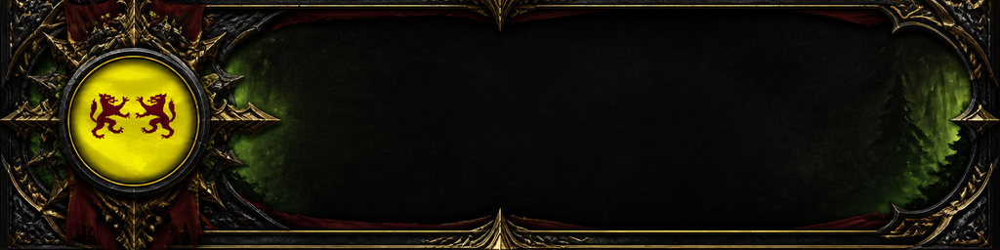

# Chevaliers Translators (v0.14.8)



Traduction du chat de World of Warcraft entre les langues européennes, **sur le PC du joueur**
(llama.cpp, aucun serveur en ligne). Deux parties :

- l'**addon** `ChevaliersTranslators` (toutes les versions du jeu : Retail, Forever, Classic...)
  relaie le chat par un bandeau de pixels en bas à droite de l'écran et cache le texte des
  messages de joueurs ;
- l'**application** `ChevaliersTranslators.exe` (Windows) lit le bandeau, traduit, et redessine
  le chat traduit par-dessus le jeu (chat miroir) ; Maj+Entrée dans la boîte de saisie envoie ton
  texte traduit.

Règle : tout message dans une autre langue que celle du client est traduit dans la langue du
client ; les acronymes du jeu passent par le dictionnaire, les noms de lieux, donjons et raids
prennent le nom du client (`app/data/termes.tsv`).

Code source : <https://github.com/Heaumite/chevaliers-translators>, sous licence **GPL-3.0 ou
ultérieure** (`LICENSE`). Signature du code : `docs/CODE_SIGNING_POLICY.md` (demande à SignPath
Foundation : `docs/SIGNPATH.md`).

Phase 1, jalon J1 (fondation) : `docs/PLAN_PHASE1.md`. Phase 0 (kit de test, résultats) :
`docs/PHASE0.md`, `docs/BILAN_PHASE0.md`, `docs/REGLE_MODELES.md`.

## Pour le joueur

1. Lancer `ChevaliersTranslators.exe`. Aucune fenêtre : le **médaillon aux deux lions** apparaît
   près de l'horloge (flèche ^ si Windows l'a rangée). L'addon est posé ou mis à jour dans toutes
   les versions de WoW trouvées ; l'ancien addon de test `CT_Spike` est retiré, ses réglages repris.
2. Lancer WoW : la traduction démarre seule à la connexion du personnage, sans `/reload`.
   `/reload` n'est demandé que si l'application a été lancée **après** la connexion (l'addon ne
   relit la présence de l'application qu'à la connexion et au `/reload`). Première installation
   pendant que le jeu tourne : redémarrer le jeu (la liste des addons n'est lue qu'au démarrage) ;
   une bulle le rappelle.
3. WoW fermé : la traduction s'arrête 20 s après et rend la mémoire vidéo ; elle reprend à
   l'ouverture suivante, pour la version du jeu lancée.

Menu de l'icône (clic gauche ou droit) : état (version du jeu, langue de traduction), **Modèles de
traduction...** (fenêtre des modèles : moteur, pack low, autres modèles), **Journal de
l'application**, **Désinstaller...**, **Quitter**.

### Désinstallation (0.14.3)

Menu de l'icône, **Désinstaller...** : l'addon et sa présence sont retirés de toutes les versions
de WoW trouvées, puis l'application s'arrête. Oui : les modèles, le moteur, les journaux et les
réglages de l'addon (SavedVariables) sont supprimés aussi ; Non : seuls l'addon et sa présence.
Ce qui est encore ouvert (l'exécutable lancé depuis le dossier de l'addon, le journal) est retiré
quelques secondes après l'arrêt. WoW ouvert : le relancer ensuite. À la main : supprimer
`Interface\AddOns\ChevaliersTranslators` et `ChevaliersTranslators_Live` dans chaque version du
jeu, puis `%LOCALAPPDATA%\ChevaliersTranslators`, puis l'exécutable.

### Confidentialité

Rien n'est envoyé sur le réseau, sauf les téléchargements demandés : le moteur llama.cpp (GitHub)
et les modèles (Hugging Face), qui ne contiennent que le nom des fichiers. Les messages sont
traduits sur le PC (serveur local `127.0.0.1`) ; l'application lit sur place une petite zone en bas
à droite de la fenêtre du jeu (le bandeau), sans garder ni envoyer de capture ; le presse-papiers et
Ctrl+V puis Entrée ne servent qu'après Maj+Entrée. Ni télémétrie, ni compte.

Quitter l'application arrête la traduction, mais l'addon ne le sait qu'au prochain `/reload` :
d'ici là, les messages des joueurs restent cachés dans le chat. Pour couper la traduction en jeu
proprement : `/chevaliers off`.

### Commandes en jeu

| Commande | Effet |
| --- | --- |
| `/chevaliers` | aide |
| `/chevaliers on` / `off` | traduction du chat active / coupée (gardé aux connexions suivantes) |
| `/chevaliers langue auto` / `xx` | langue de l'envoi traduit (aussi le bouton Trad, à droite de la saisie) |
| `/chevaliers info` | état de l'addon |
| `/chevaliers diag` | rapport (fenêtres de chat, messages reçus), recopié dans le journal de l'application |
| `/chevaliers monter` / `non` | accepter / écarter le modèle supérieur proposé sur l'écran (0.14) |
| `/chevaliers tele auto` / `on` / `off` | dispositif télévision : selon l'écran vu par l'application (par défaut), forcé, coupé (0.14) |
| `/chevaliers dev` | liste des outils de développement (test, ping, miroir, perf, essai...) |

Maj+Entrée dans la boîte de saisie — ou **Maj+clic sur le bouton Trad** (0.14.7) : la traduction est collée puis envoyée (Ctrl+V et Entrée
simulés seulement dans ce cas). Entrée seule envoie ton texte tel quel.

### Présence de l'application (0.13.1)

L'application écrit toutes les 2 s un petit addon, `ChevaliersTranslators_Live`, avec l'heure
(`t`), et 0 quand on la quitte. Le fichier note aussi l'heure à laquelle le jeu l'exécute (`lu`).
À la connexion, l'addon compare les deux : la présence est jugée au moment de la lecture, quelle
que soit la durée de l'écran de chargement qui suit (plus d'une minute parfois sur retail : en
0.13.0, l'addon la croyait périmée et demandait un `/reload` alors que l'application tournait).
L'application écrit cette présence dès son lancement, WoW ouvert ou non.

### Fichiers

`%LOCALAPPDATA%\ChevaliersTranslators\` : `modeles\` (modèles de traduction), `llama\` (moteur),
`journal\` (journaux de l'application et de la fenêtre des modèles, 10 derniers de chaque),
`traduction-serveur.log`, `phrases.tsv` (traductions gardées), `mesures.tsv` (mesures prises
pendant le jeu), `choix.tsv` (modèle accepté), `propositions-refusees.tsv`, polices et icônes du
jeu en cache.

## 0.14.8 (12/11/2026)

- **Affichage continu, sans trou ni clignotement** : les lignes s'affichent dans l'ordre d'arrivée,
  chacune quand elle est prête (traduite, ou rien à traduire : butin, artisanat, même langue). Une
  ligne dont la traduction est en route retient un court instant les lignes plus récentes, puis tout
  se révèle dans l'ordre — le chat paraît couler en continu, sans case vide (avant : trou pendant
  l'attente) et sans voir le texte passer de l'original au traduit.
- **Attente ajustée à la vitesse du modèle** : ce petit délai d'affichage suit le temps de
  traduction réellement mesuré (médiane récente, allongée si la file est chargée) : modèle rapide,
  chat vif ; modèle plus lourd, délai un peu plus long, toujours sans trou. Si la traduction dépasse
  le budget, la ligne s'affiche telle quelle et la traduction la remplace à son arrivée — le flux ne
  cale jamais. L'équilibre traduction/affichage est ainsi automatique.
- **Mises à jour vérifiées dans chaque version du jeu** : à son lancement, l'application remplace
  l'addon dans toutes les versions de WoW et **vérifie** que chacune porte bien la nouvelle version,
  pour qu'une ancienne ne se charge pas à la place. Si la version ouverte vient d'être mise à jour,
  une bulle prévient : « addon en version X, tape /reload pour charger la nouvelle version ». Si une
  version n'a pas pu être mise à jour, l'application le signale (fermer le jeu, relancer
  l'application).

## 0.14.7 (12/11/2026)

- **Traduire et envoyer en un clic** : Maj+clic sur le bouton Trad fait la même chose que
  Maj+Entrée dans la boîte de saisie (le texte part à la traduction, l'application le colle traduit
  et l'envoie). L'infobulle du bouton le rappelle : « Traduire et envoyer… : Maj+Entrée ou Maj+clic
  ici. »
- **Plus d'emplacement vide pendant la traduction** : quand une traduction met un peu de temps, la
  ligne s'affiche aussitôt telle quelle (texte d'origine) au lieu de laisser un trou qui faisait
  penser à un bug ; la traduction la remplace à son arrivée. L'attente avant d'afficher est ramenée
  à un court instant (le temps de laisser une traduction très rapide s'afficher directement).

## 0.14.6 (12/11/2026)

- **Menu de langues (bouton Trad) réordonné** : les régions sont en haut (Europe du Nord d'abord),
  les langues courantes et le mode automatique (Automatique, Français, Anglais, Allemand, Espagnol,
  Italien, Russe) en bas.
- **Copie du chat avec le nom** : l'icône de copie au bout d'un message copie désormais le nom du
  joueur puis le message (« Hazè : bonjour »), sans l'heure, le canal ni l'acronyme de langue.
- **Guide d'installation en jeu** : à la première utilisation de l'addon (et par `/chevaliers
  guide`), un petit panneau avec la bannière et le logo rappelle où se trouve l'application
  compagnon (`ChevaliersTranslators.exe`, dans le dossier de l'addon), comment la lancer, et qu'elle
  n'est pas encore signée (demande en cours auprès de la SignPath Foundation), avec le lien du
  dépôt. Il se ferme par la croix ou au bout de 60 s. Bannière ajoutée à `Media/Banniere.tga`.

## 0.14.5 (12/11/2026) : phrases entières

- **Plus de traduction coupée par « … »** : quand une traduction était plus longue que l'original
  et que des lignes du jeu l'encadraient (« Vous créez : [Cuir léger]. » au-dessus, « Hyène
  Jappecroc meurt… » en dessous), elle n'avait que la place de l'original et finissait coupée.
  Désormais toutes les lignes lisibles du chat sont redessinées par l'application, celles du jeu
  comprises (butin, artisanat, système, créatures, messages des addons), sans traduction et avec
  leurs couleurs, liens et icônes : la traduction prend les lignes qu'il lui faut et les plus
  anciennes remontent, comme dans WoW. Seules les lignes secrètes (instances, combat) restent
  dessinées par WoW ; entre elles, la place reste celle de l'original.
- Les lignes du jeu passent par le bandeau (un peu plus de trafic) mais ne sont pas recopiées au
  journal ; l'addon les signale par le bit de poids fort du numéro de fenêtre.

## Correctif 0.14.4 (11/11/2026)

- **Messages redessinés sur les lignes du jeu** : quand le chat mêle des lignes du jeu avec une
  icône (« Seiyya crée : [Flacon des Magistères fugace] », icône de qualité) et des messages de
  joueurs, ceux-ci étaient redessinés un peu trop bas, sur les lignes du jeu. Une icône plus haute
  que le texte agrandit la ligne chez WoW ; l'application comptait toutes les lignes à la même
  hauteur. L'addon envoie maintenant la hauteur réelle de chaque ligne (écart à la hauteur
  théorique, au quart de pixel ; inconnue si WoW la rend secrète) et les lignes des joueurs gardent
  exactement leur place. Journal : `[miroir] ChatFrame1 : …, N ligne(s) plus haute(s) chez WoW`.

## Nouveautés 0.14.3 (11/11/2026) : préparation de la signature par SignPath Foundation

- **Champ de bataille** : plus d'erreur Lua « attempt to perform boolean test on local 'afk' (a
  secret boolean value) » (Core.lua:54, 461 fois en instance JcJ) : WoW y rend l'état d'absence
  secret ; l'addon ne teste plus une valeur avant d'avoir vérifié qu'elle est lisible (même
  correction pour le combat, l'instance, le canal de zone, les couleurs et la géométrie du chat).
  Le harnais refuse désormais tout test d'une valeur avant ce contrôle.
- **Premier modèle** : la première fois dans des conditions données (version du jeu, définition :
  aucune mesure dans `mesures.tsv`), règle de la première installation, WoW compté 7 Go (carte de
  16 Go : 7,6 Go pour le modèle, le 7B) ; ensuite, la mémoire vidéo réellement libre en jeu, puis
  les relevés font monter ou descendre le modèle (gouverneur de la 0.14.2).

- **Code ouvert** sous GPL-3.0 ou ultérieure (`LICENSE`, `app/Cargo.toml`, lignes `## X-License`
  et `## X-Website` du `.toc`), dépôt public prévu : `Heaumite/chevaliers-translators`.
- **GitHub Actions** (`.github/workflows/compilation.yml`) : tests Linux (Rust, vecteurs de
  l'encodeur, harnais de l'addon), tests et compilation sous Windows ; sur étiquette `vX.Y.Z`,
  signature par SignPath (dès la configuration faite), paquet avec licence et empreinte SHA-256,
  publication dans Releases.
- **SignPath** : configuration d'artefact (`signpath/artifact-configuration.xml`), page de
  politique de signature (`docs/CODE_SIGNING_POLICY.md`), démarches et textes de la demande
  (`docs/SIGNPATH.md`).
- **Désinstallation** depuis le menu de l'icône (condition de SignPath pour un programme qui
  installe quelque chose).
- Version des exécutables en quatre nombres (`0.14.3.0`), la même en texte et en nombres, comme
  SignPath la vérifie ; téléchargements (curl) arrêtés avec l'application, plus de téléchargement
  orphelin après Quitter.

## Nouveautés 0.14.2 (11/11/2026)

- **Plus de réserve de 1 Go de mémoire vidéo** : un modèle n'est plus écarté parce qu'il ne
  laisserait pas 1 Go libre d'après l'estimation. La chaîne garde tous les modèles qui tiennent à
  côté d'un WoW réglé au plus bas ; en jeu, le **gouverneur de la mémoire vidéo** (module
  `gouverneur`) fait le reste :
  - premier modèle choisi une fois le joueur en jeu (à l'écran de connexion, WoW prend bien moins
    de mémoire) : le meilleur qui tient dans la mémoire vidéo libre d'alors ;
  - **descente** près de la saturation : moins de 4 % de la carte libres (au moins 512 Mo ; 0,64 Go
    sur une carte de 16 Go) à deux relevés de suite, le modèle passe à l'étape plus légère, même en
    combat (sa mémoire revient au jeu tout de suite). Le seuil reste au-dessus des 0,3 Go qui
    restaient lors de la réinitialisation du pilote graphique du 09/11 (TranslateGemma 12B) ;
  - **remontée** hors combat quand la place revient : de quoi loger le modèle supérieur et 0,25 Go
    au-dessus du seuil, une minute de suite. Un modèle qui vient de saturer attend 3 min avant
    d'être repris, puis 6, 12… jusqu'à 30 min ;
  - **réglages graphiques de WoW changés** (qualité, échelle de rendu, textures, résolution, mode
    d'affichage) : l'addon le signale (numéro dans la trame de vie, événement `CVAR_UPDATE`) et la
    place est réévaluée aussitôt, sans attente.
  Un manque de mémoire constaté n'interdit plus un modèle (il reste noté dans `essais.tsv`) ; un
  plantage (pilote réinitialisé) l'interdit toujours. Journal : `[traduction] mémoire vidéo presque
  pleine (… libres) : … -> …`, `[traduction] place revenue dans la mémoire vidéo …`.
- **Éditeur « Chevaliers »** : les deux exécutables portent leurs informations de version
  (éditeur Chevaliers, produit Chevaliers Translators, description, version, copyright), visibles
  dans Propriétés > Détails et dans le Gestionnaire des tâches ; ressource écrite par `build.rs`,
  identique octet pour octet à celle de `llvm-rc`. `outils/signer.ps1` signe les exécutables avec
  un certificat « Chevaliers » créé pour ce PC : Windows affiche alors « Éditeur : Chevaliers ».
  Ce certificat ne vaut que sur ce PC ; pour les autres joueurs (SmartScreen, Smart App Control),
  il faudra un certificat d'une autorité reconnue (Azure Trusted Signing, SignPath pour un projet
  au code ouvert, ou un certificat payant), prévu au jalon J6.

## Correctif 0.14.1 (11/11/2026)

- **Traduction qui ne démarrait plus** (0.13.3 et 0.14.0) : à l'ouverture de WoW, l'application
  restait bloquée avant de lire le bandeau. Le fil de capture cherchait la fenêtre de WoW en
  lisant le titre de toutes les fenêtres, y compris celles de l'application ; pour celles-ci,
  Windows attend que le fil principal réponde, et le fil principal attendait justement le fil de
  capture. Conséquences : plus de présence écrite (« l'application n'est pas lancée » à la
  connexion) et rien de redessiné, quel que soit l'écran ou le mode d'affichage. Les fenêtres de
  l'application sont maintenant écartées de cette recherche, et un démarrage de capture qui
  traîne plus de 10 s devient une erreur (nouvel essai, bulle) au lieu d'un blocage silencieux.

## Nouveautés 0.14.0 (11/11/2026)

- **Modèles téléchargés d'office** : au premier lancement, le moteur llama.cpp puis tous les
  modèles qui peuvent tourner sur le PC (le pack low d'abord : la traduction démarre dès qu'il est
  là) se téléchargent en fond, un à la fois. Infobulle de l'icône : avancement ; bulle à la fin ;
  panneau sur le jeu une fois par session. WoW ouvert, le débit est bridé (un quart du débit mesuré
  WoW fermé, entre 1 et 8 Mo/s) ; il reprend à pleine vitesse à la fermeture du jeu. À la fin de
  chaque modèle, le meilleur installé selon la règle devient actif (bascule hors combat).
- **Mesures pendant le jeu** : toutes les 5 s, la mémoire vidéo libre, celle de WoW et le débit du
  chat, par conditions (version du jeu et définition), gardées dans `mesures.tsv`. Rien n'est
  changé pendant la partie : ces mesures servent à proposer mieux.
- **Proposition d'un modèle supérieur** : après 30 min de jeu mesurées (dont 10 en instance pour
  la marge la plus fine), un modèle qui tient d'après les mesures mais pas d'après la règle est
  proposé par un panneau sur le jeu, hors combat, une fois par session, **avec un avertissement**
  (il peut provoquer des plantages si Windows ou WoW reprennent de la mémoire vidéo). Jamais actif
  tout seul : `/chevaliers monter` pour l'essayer (téléchargé s'il manque, bascule hors combat,
  retour seul au modèle actuel en cas d'échec), `/chevaliers non` pour ne plus le proposer.
- **Télévision** : l'application reconnaît les écrans branchés dès son lancement (nom donné par
  l'écran, liaison HDMI, HDR, taille), puis celui de WoW dès que le jeu s'ouvre, avant la connexion
  du personnage. Sur une télévision, l'addon applique le **dispositif télévision** : le texte du
  chat du jeu n'est plus caché ; le chat traduit le recouvre, sur une plaque sombre qui s'efface
  avec les lignes. Si rien ne peut s'afficher par-dessus le jeu sur cet écran, le joueur garde le
  chat du jeu (avant : chat vide). Aucun réglage à changer dans WoW : plus de bulle demandant le
  mode « Fenêtré (plein écran) » (WoW en DirectX 12 laisse les fenêtres s'afficher par-dessus,
  même en plein écran). Le journal note les écrans (`[écran] …`) et le mode d'affichage de WoW.
- **Combat** : rien n'est redessiné ni affiché sur le jeu pendant un combat (chat du jeu, panneaux
  cachés) ; la traduction continue, et hors combat le chat traduit revient avec tout ce qui a été
  traduit, ainsi que le bilan des messages reçus pendant le verrouillage du chat.

## Nouveautés 0.13.3 (essais du 10/11/2026)

- **Donjons et raids** : plus d'erreur Lua (« attempt to compare … secret number value ») : en
  instance, WoW rend certaines mesures du chat secrètes ; l'addon ne les lit plus. Pendant le
  verrouillage du chat (combat), le chat officiel s'affiche ; les messages reçus sont gardés sans
  être lus et relayés à la fin du combat s'ils sont devenus lisibles : leurs traductions
  s'affichent d'un bloc (« Pendant le combat : … ») une fois le combat fini. Le journal dit
  combien sont restés secrets (`[addon] combat : …`).
- **Écran** : le chat traduit suit la zone de jeu de WoW, sur n'importe quel écran (télévision 4K
  à côté d'un autre écran : il se dessinait sur l'écran principal, donc invisible) ; la zone lue
  du bandeau suit la largeur de WoW ; l'écran de WoW est noté au journal (`[écran] …`) ; une
  bulle prévient si WoW est en plein écran exclusif (rien ne peut s'afficher par-dessus).
- **Tailles égales** : la police du chat traduit garde la taille de WoW ; entre deux lignes du
  jeu, les messages des joueurs se partagent la place, les plus récents en bas ; s'il en manque,
  les plus anciens de ce groupe ne sont pas redessinés (la ligne la plus récente est coupée
  avec « … » au besoin).
- **Bandeau discret** : immobile quand il n'y a rien à envoyer (plus de clignotement), et plus
  sombre (couleurs à 45 %).
- **Portée des canaux** (Trad:AUTO) : la langue d'envoi suit le canal dans la zone en cours
  (Général, Commerce, Défense locale ont un secteur géographique) et les joueurs proches pour
  Dire et Crier ; chuchotement : la langue de l'interlocuteur, comme avant.
- **Fautes et mots du jeu** : « great job », « well done »… sont reconnus ; un mot à une faute
  près d'un mot connu (lettre en trop, en moins, remplacée, deux lettres échangées) compte aussi.
- **Journal** : écrit par l'application elle-même (certains lancements de la 0.13.2 laissaient
  un journal vide).

## Dépôt

```
chevaliers-translators/
  addon/ChevaliersTranslators/  addon (Lua 5.1) : Encoder, Banner, Core, Mirror
  app/                          Rust : bibliothèque `ct` (src/lib.rs) et deux exécutables
    src/main.rs                   ChevaliersTranslators.exe (sans console, icône, journal)
    src/bin/ct-outils.rs          outils de développement (console) : live, install, bench,
                                  tests-en-jeu, interface, fonts, diagnostic, selftest...
    data/termes.tsv               dictionnaire (noms localisés, jargon, termes gardés)
  outils/lua_harness.py         harnais hors jeu de l'addon (imitation de l'API WoW)
  outils/paquet.ps1             zip de distribution (addon + application + licence)
  outils/signer.ps1             signature propre au PC (certificat « Chevaliers »)
  .github/workflows/            compilation, tests, signature SignPath, publication
  signpath/                     configuration d'artefact pour SignPath
  docs/                         plan, bilan et archive de la phase 0
  media/                        logo (512x512) et bannière (1024x256) d'origine, en TGA
```

Le logo sert d'icône à l'exécutable (`app/build.rs` écrit le fichier de ressources sans outil
externe, éditeur de liens MSVC), à l'icône près de l'horloge, à la fenêtre des modèles, au
panneau affiché sur le jeu et à la liste des addons du jeu (`Media/Logo.tga`, ligne
`## IconTexture`) ; la bannière, d'en-tête à la fenêtre des modèles.

Style visuel (0.13.2), tiré de la bannière et du logo, partout où l'application dessine :

| Élément | Origine | Usage |
| --- | --- | --- |
| Champ noir `#0e0d0a`, fer `#191712` | fond et cadre de la bannière | fond de la fenêtre et du panneau en jeu, plaque de la liste |
| Or du filigrane `#c9a55a` / `#e6c77e` | ornements du cadre | titres (police de WoW, Friz Quadrata), filets, boutons principaux, cadre du panneau en jeu |
| Or du médaillon `#f0d000`, gueules `#c4161c` | « d'or à deux lions de gueules » | part du modèle et réserve dans la jauge, étiquette High |
| Pourpre des drapés `#7a1216` | drapés de la bannière | bande du modèle actif |
| Sinople `#3d5e1b` | lueur de la forêt | part de WoW dans la jauge, verdicts réussis |
| Losanges d'or | clous de l'anneau du médaillon | note de qualité des modèles |

Toujours sombre, comme la bannière ; hachures héraldiques gardées dans la jauge (la couleur
n'est jamais seule à porter le sens).

Les fichiers Lua sont compilés dans l'application (`include_str!`) : elle pose l'addon elle-même.
Le `.toc` du dépôt sert au paquet ; un test vérifie qu'il a la version de l'application.

## Développement

```powershell
cd "<dépôt>\app"
cargo test --release --target-dir target-win
cargo build --release --target-dir target-win
powershell -ExecutionPolicy Bypass -File ..\outils\signer.ps1            # signature « Chevaliers » (ce PC)
.\target-win\release\ChevaliersTranslators.exe          # l'application
.\target-win\release\ct-outils.exe live --wow $wow --flavor _retail_   # ancien `ct-spike live`, avec console
powershell -ExecutionPolicy Bypass -File ..\outils\paquet.ps1           # dist\ChevaliersTranslators-0.14.8.zip
```

Sous Linux (vérification) : `cargo test --release`, `python3 outils/lua_harness.py vectors .` et
`python3 outils/lua_harness.py mock . app/target/release/ct-outils`.

## Vérifié avant livraison (0.14.8)

- 117 tests Rust sous Linux (116 sous Windows) : dont, en 0.14.4, les lignes du jeu plus hautes
  (icône) qui gardent les messages des joueurs à leur place ; en 0.14.3, la règle de la première
  installation (WoW compté 7 Go), la désinstallation (addon et
  présence retirés de chaque version, autres addons gardés ; réglages et données sur demande) ; en 0.14.2, le gouverneur de la mémoire
  vidéo (descente près de la saturation, même en combat ; remontée hors combat après une minute de
  place ; attente de 3 puis 6 min après une saturation ; réglages graphiques changés), la chaîne
  sans réserve (retail au maximum sur la carte de 16 Go : 7B et 4B gardés en tête, manque de
  mémoire constaté qui n'interdit plus), la fenêtre des modèles sans réserve, et la ressource de
  version comparée octet pour octet à celle de `llvm-rc` (fichier `.res` relu par `llvm-cvtres`) ;
  en 0.14 : bridage des téléchargements, mesures, propositions, télévisions, plaques du dispositif
  télévision ; et toujours le `.toc` et `Core.lua` alignés sur l'application, l'icône.
- Harnais Lua : encodeur identique sous Lua 5.1 et LuaJIT (62 vecteurs) ; trames peintes décodées
  par `ct-outils` ; valeurs secrètes, verrouillage du chat et relais après le combat ; bandeau
  immobile au repos ; valeurs secrètes jamais testées avant contrôle (relecture des sources, et
  absence et instance secrètes en champ de bataille) ; ligne plus haute chez WoW signalée à
  l'application ; toutes les lignes lisibles cachées et envoyées, celles du jeu sans être
  recopiées au journal (0.14.5) ; menu de langues réordonné et aide citant le guide (0.14.6) ;
  Maj+clic sur Trad qui traduit et envoie (0.14.7) ; affichage continu dans l'ordre d'arrivée avec
  attente ajustée au temps de traduction, et mise à jour vérifiée dans chaque version (0.14.8) ;
  réglage graphique modifié (trame de vie repeinte, « réglages graphiques de
  WoW modifiés » côté application ; un réglage sans rapport ne repeint rien) ; `monter` / `non` ; vrai fichier de présence avec `e = 1` : texte du jeu
  laissé visible, description « dispositif télévision » reçue par l'application ;
  `/chevaliers tele off` puis `auto` ; retour à l'écran de PC (texte caché).
- Code Windows (écrans par DisplayConfig et EDID du registre, icône, menu, bulles, journal,
  téléchargements, serveur arrêté avec l'application) compilé contre `windows-sys` avec la
  configuration Windows forcée, sans avertissement nouveau ; **pas encore exécuté sous Windows** :
  c'est le test ci-dessous.

## Test de la 0.14.8 (PowerShell)

Voir la réponse de livraison pour les commandes à copier-coller. Points à vérifier :

| Point | Attendu |
| --- | --- |
| Lancement | aucune console ; médaillon près de l'horloge et sur l'exécutable ; infobulle « En attente de World of Warcraft » |
| Installation | journal : addon 0.14.8 posé et vérifié dans chaque version ; `[écran]` : écrans branchés, télévision reconnue |
| Téléchargements | infobulle de l'icône : pourcentage ; WoW ouvert : « débit bridé » ; à la fin : bulle « Modèles de traduction prêts » |
| Télévision | WoW sur la télé : « Écran de télévision » à la connexion ; chat traduit sur plaque sombre ; `/chevaliers tele off` le cache comme sur un écran de PC |
| Combat | rien de dessiné pendant le combat ; à la fin, chat traduit et bilan |
| Désinstallation | menu de l'icône, Désinstaller..., Non : dossiers `ChevaliersTranslators` et `ChevaliersTranslators_Live` retirés de chaque version de WoW, modèles gardés ; relancer l'exe : l'addon est reposé |
| Éditeur | Propriétés de `ChevaliersTranslators.exe` > Détails : société Chevaliers ; après `signer.ps1`, onglet Signatures numériques : Chevaliers |
| Mémoire vidéo | `[traduction] mémoire vidéo libre en jeu : …` puis le modèle choisi ; changer l'échelle de rendu dans WoW : « réglages graphiques de WoW modifiés », descente ou remontée selon la place |
| Démarrage de la traduction | à l'ouverture de WoW, le journal montre « Décodeur en écoute », puis « Traduction : vers FR » et la ligne `[écran] WoW sur … ; échelle …` |
| Traduction | application lancée avant la connexion : « Traduction du chat active » à l'arrivée en jeu, **aucun /reload** ; `/dire hello` affiché `[EN] bonjour` |
| Application après la connexion | `/reload` demandé (seul cas) ; après `/reload`, traduction active |
| Fermeture de WoW | 20 s après : « traduction arrêtée : WoW fermé » au journal, plus de `llama-server` |
| Deuxième lancement | message « déjà lancé » |
| Quitter | confirmation ; icône et `llama-server` disparus |
